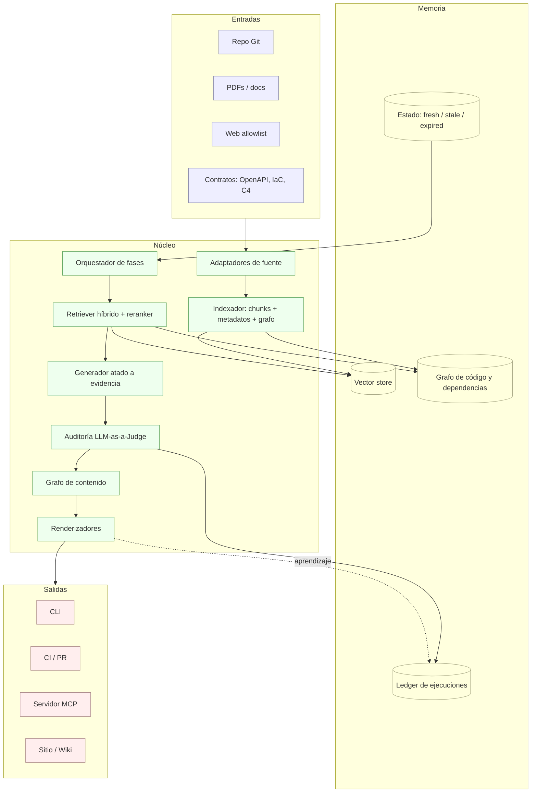

# Guía v2 — Diseño de un Agente Autónomo de Documentación Técnica

> **Cambio de encuadre respecto a v1.** v1 describía un *pipeline RAG* con extras de gobernanza.
> v2 describe un **producto**: un motor agnóstico de documentación que se invoca, entrega, se
> audita a sí mismo y aprende de cada instalación — sin convertirse en carga operativa.

---

## 0. Correcciones aplicadas (v1 → v2)

| # | Afirmación / decisión de v1 | Problema | Corrección en v2 |
|---|---|---|---|
| 1 | «nv-embed-v1 de 768 dimensiones» | NV-Embed-v1 produce **4096** dims; ningún NV-Embed es de 768 | Dimensión, modelo y versión **declarados en el perfil** e indexados como metadato; el motor es *model-agnostic* (§4) |
| 2 | «RAG Híbrido» | Se usa para *heterogeneidad de fuentes*, no para *recuperación híbrida* | Dos ejes separados: **multifuente** (código/PDF/web/OpenAPI) y **recuperación híbrida real** (BM25 + denso + match de símbolo, fusión RRF) (§3.3) |
| 3 | «erradicar las alucinaciones» | No es garantizable; promesa no verificable | **Generación atada a evidencia**: toda afirmación lleva cita; si no hay soporte, el agente **se abstiene** y lo reporta (§3.5) |
| 4 | «temperatura 0 ⇒ repetibilidad» | Reduce varianza, no la elimina | Juez **separado del generador**, temp 0 + seed + versión fijada, y **calibrado contra golden set** (kappa ≥ 0.70) (§5) |
| 5 | PyPDF para PDFs técnicos | Pierde tablas, fórmulas y orden de lectura | Extracción *layout-aware* (`pdfplumber` / `Docling`), tablas a Markdown, OCR solo si hace falta (§3.1) |
| 6 | AST + RepoAgent/Repowise por lenguaje | No escala a N lenguajes | `tree-sitter` como sustrato + **consultas de símbolos por lenguaje** como adaptador (§3.2) |
| 7 | Regenerar dentro del pre-commit | Bloquea al desarrollador; conflictos de merge | Pre-commit = **validación rápida** (falla si hay `stale`); regeneración en **CI post-merge → PR** (§7) |
| 8 | 4 niveles generados por separado | Derivan entre sí: el mismo mal que v1 denuncia | **Grafo de contenido** único + 4 renderizadores (§9) |
| 9 | Umbral único «< 8.5/10» | Sin sentido para 4 métricas distintas; sin calibración | Umbral **por métrica** + *hard gates* no negociables + golden set (§5) |
| 10 | Re-ranking sobre top-10 por fuente | Correcto pero incompleto: sin fusión previa ni match léxico | `top-k` por fuente → **RRF** → rerank sobre los ~50 mejores → 10–15 finales (§3.4) |
| 11 | Web como «respaldo» sin control | Contenido web cambia: rompe reproducibilidad y trazabilidad | Web con **allowlist** + *snapshot* cacheado y hasheado (§3.1) |
| 12 | Chunks 512–1024 tok, overlap 128 | Rango razonable pero corta símbolos grandes | Default igual, pero **un símbolo por chunk** cuando cabe; funciones largas se parten por nodos internos, nunca por tamaño ciego (§3.2) |
| 13 | Voces narrativas (incl. `caveman`) | Vago: no hay contrato de salida | Voz = **presupuesto de tokens + estructura obligatoria**, no adjetivo (§9) |
| 14 | Ausencias | Seguridad, coste, idempotencia, contrato de entrada, invalidación de índice, telemetría | Secciones §3.6, §6, §7, §8, §11 |

**Nota sobre fuentes de v1.** Las referencias a UNCPBA, «Folium Labs» y «César Cancino» deben
verificarse y citarse con DOI/URL antes de sostener una decisión de diseño; RepoAgent (OpenBMB),
C4InterFlow, Bucaioni (Architecture as Code), RAGAS, FActScore, MCP, NV-Embed y NV-RerankQA sí son
verificables y se mantienen.

---

## 1. Principios de diseño (no negociables)

1. **Una sola fuente de verdad.** Todo hecho técnico se escribe una vez; los cuatro niveles de
   salida son *renderizaciones*, no generaciones independientes.
2. **Sin evidencia no hay afirmación.** Cada claim enlaza a `chunk_id` con `file:line` o a
   documento/URL con hash de versión.
3. **Idempotencia.** Ejecutar dos veces sobre el mismo commit produce **diff vacío**. Si no, el
   control de frescura es ruido.
4. **Incrementalidad real.** El coste de un commit es proporcional a lo que cambió, no al repo.
5. **Agnosticismo por adaptadores.** Lenguajes, fuentes, notaciones y destinos son *plugins*, no
   ramas de `if` en el núcleo.
6. **Autonomía con compuerta.** El agente decide solo dentro de un presupuesto de calidad y coste
   declarado; fuera de él, propone y pide revisión. Nunca bloquea a un humano para justificarse.
7. **Mejora con reversibilidad.** Todo artefacto aprendido está versionado y se puede revertir.

---

## 2. Arquitectura en capas



**Regla de oro:** el núcleo no conoce ningún lenguaje, formato ni proveedor de modelos. Todo eso
entra por *puertos* (§4).

---

## 3. Pipeline (fases corregidas)

### 3.1 Ingesta multifuente
- **Git:** clonado superficial + `git log` para *ownership*, *churn* y co-cambio de archivos.
- **Código:** parseo a AST y extracción de símbolos (declaraciones, firmas, llamadas).
- **PDF/docs:** extracción layout-aware; tablas → Markdown; cada página conserva `page` y `hash`.
- **Web:** solo dominios permitidos; se guarda **snapshot** con hash de contenido y fecha. Si el
  snapshot no existe, la fuente es *no citable* hasta que se capture.
- **Contratos (OpenAPI/IaC/C4):** se ingieren como **verdad prescriptiva**, con etiqueta propia, para
  el motor de conformidad (§6).

### 3.2 Segmentación sintáctica y metadatos
- Un **símbolo por chunk** cuando cabe en el presupuesto; si excede, se parte por nodos internos
  (bloques, ramas, métodos) respetando fronteras sintácticas. Nunca corte por tamaño ciego.
- Default: objetivo 512–1024 tokens, `overlap` 128 **solo** cuando hubo corte.
- Cabecera inyectada obligatoria y además almacenada como campos consultables:

```json
{
  "chunk_id": "git:acme/billing@a8f3b92:src/services/data_service.py#DataService.process_record",
  "source_type": "git_repository",
  "repo": "acme/billing",
  "commit": "a8f3b92",
  "file_path": "src/services/data_service.py",
  "lang": "python",
  "enclosing_symbol": "DataService.process_record",
  "symbol_kind": "method",
  "line_start": 142,
  "line_end": 187,
  "dependencies": ["src/utils/format_helper.py", "src/models/entity.py"],
  "content_hash": "sha256:9f1c…",
  "embed_model": "nv-embed-v1@4096",
  "chunker": "ast-v2",
  "ingested_at": "2025-01-01T00:00:00Z",
  "content_prefix": "[File: src/services/data_service.py | Class: DataService | Method: process_record | lines 142-187 | commit a8f3b92]"
}
```

### 3.3 Recuperación híbrida (lo que v1 llamaba «híbrido» sin serlo)
**Paso previo obligatorio — expansión de consulta por glosario.** La pregunta llega en español y el
código está en inglés: «cadena de filtros» no aparece en ningún `securityFilterChain`. El perfil
declara un glosario (frase → términos de código) que se aplica antes de recuperar.

> **Medido en el piloto:** el glosario aporta +0.525 de recall@10 en preguntas en español; las
> embeddings multilingües aportan +0.025. Es la palanca de mayor retorno y coste cero de inferencia.

Después, tres recuperadores en paralelo sobre las colecciones activadas:
1. **Denso** — embeddings multilingües del perfil, similitud coseno.
2. **Léxico** — BM25 sobre identificadores, rutas y comentarios.
3. **Estructural** — coincidencia exacta de símbolos y expansión por vecinos del grafo de
   dependencias (esto es lo que responde «¿quién llama a `process_record`?»).

**Fusión:** RRF (Reciprocal Rank Fusion) con pesos por tipo de consulta. Sin normalización de escalas
y sin que un canal aplaste a los demás.

**Enrutado por forma de la consulta.** Si el usuario teclea código (punto entre palabras, `_`,
kebab-case o camelCase real) manda el canal estructural; si escribe una pregunta, el denso. Criterio
estricto: una palabra capitalizada no es un identificador —«Spring Boot» y «CORS» aparecen en
preguntas humanas y enrutarlas mal cuesta 0.12 de MRR.

**Diversity cap:** máximo 2 fragmentos por archivo. Sin esto, un archivo con muchos chunks útiles
ocupa media lista de resultados y la documentación acaba citando ocho veces el mismo fichero.

### 3.4 Re-ranking
Cross-encoder sobre los ~50 mejores tras RRF → 10–15 finales → *diversity cap* (máx. N chunks por
archivo) para no construir un documento con un solo fichero.

### 3.5 Generación atada a evidencia
- El prompt recibe **solo** contexto recuperado, con IDs de cita.
- El modelo debe emitir *claims* con `[cite:chunk_id]`. Post-proceso: **claim sin cita se elimina**
  o se marca `⚠ sin verificar` según el modo.
- Si la cobertura de la rúbrica no se alcanza, el agente **declara el hueco** en el documento en
  lugar de rellenarlo con prosa plausible. Un hueco visible vale más que una frase inventada.

### 3.6 Presupuesto de ejecución
Cada corrida tiene `max_tokens`, `max_llamadas`, `max_segundos` y `max_coste`. Al agotarse, el
agente entrega lo completo y deja el resto como tareas `pending`, no como texto degradado.

---

## 4. Puertos de extensibilidad (agnosticismo real)

| Puerto | Contrato mínimo | Adaptadores de referencia |
|---|---|---|
| `SourceAdapter` | `list() -> Artifact[]` con `hash`, `uri`, `kind` | git, pdf, web, openapi, sql |
| `LangAdapter` | `symbols()`, `calls()`, `imports()` vía queries tree-sitter | python, typescript, java, sql, bash |
| `Embedder` | `embed(texts) -> vectors`, `dim`, `id` | local ONNX (bge/nomic), API (nv-embed) |
| `VectorStore` | `upsert`, `query`, `delete_by_filter`, `namespaces` | chroma, pgvector, qdrant |
| `Reranker` | `rank(query, docs) -> scores` | cross-encoder local, NV-RerankQA |
| `Glossary` | `expand(query) -> query` | glosario por defecto + `glossary:` del perfil |
| `RenderAdapter` | `render(ContentNode) -> str` | mermaid, plantuml, openapi, markdown |
| `Judge` | `score(doc, evidence) -> métricas` | LLM juez, verificador heurístico |
| `Publisher` | `propose(diff)`, `apply`, `revert` | git/PR, wiki, MCP read-only |

**Criterio de aceptación del agnosticismo:** añadir un lenguaje nuevo debe tocar **un solo paquete**
y **cero líneas del núcleo**.

---

## 5. Evaluación en tres niveles (y calibración del juez)

| Nivel | Qué mide | Instrumento | Puerta |
|---|---|---|---|
| **Retrieval** | ¿Trae lo que hace falta? | `recall@10`, `MRR`, exactitud de símbolo | recall@10 ≥ 0.85 |
| **Fidelidad** | ¿Lo que dice está soportado? | claims sin cita, RAGAS Faithfulness, FActScore | 0 claims sin cita |
| **Utilidad** | ¿Sirve al lector? | rúbrica 1–10 por métrica + revisión humana muestreada | ver umbrales del perfil |

**Métricas por documento** (umbral independiente, no uno solo): Exactitud, Completitud, Atribución,
Concisión — más dos nuevas que v1 no tenía: **Actualidad** (¿el doc es `fresh`?) y **Coste/página**.

**Calibración obligatoria del juez:**
1. Golden set de 40–60 casos con respuesta humana de referencia.
2. Medir acuerdo juez↔humano (kappa de Cohen ≥ 0.70) **antes** de confiar en cualquier umbral.
3. Juez distinto del generador y con versión pinneada.
4. Repetir 3 veces: si la desviación > 0.5 pts, el juez no es estable y no puede aprobar nada solo.

---

## 6. Conformidad y deriva arquitectónica (AaC)

Dos artefactos separados, comparados explícitamente:
- **Prescriptivo:** C4InterFlow/YAML, CloudFormation/Terraform, `openapi.yaml`, ADRs.
- **Descritivo:** grafo de dependencias extraído del código real.

Salidas del comparador: `match` · `undeclared_dependency` · `missing_component` · `stale_contract`.
Cada discrepancia genera una alerta con evidencia y **una** de dos acciones: actualizar el modelo
(cambio de arquitectura intencionado) o abrir issue de deuda (cambio accidental). El agente **no**
decide cuál: propone la más probable y deja el registro.

---

## 7. Autonomía, frescura e idempotencia

### Modos de ejecución
| Modo | Comportamiento | Uso |
|---|---|---|
| `propose` | Genera diff, no escribe | arranque, repos sensibles |
| `apply` | Escribe y abre PR | **default profesional** |
| `publish` | Escribe y publica si supera puertas | repos maduros con CI verde |

### Compuertas (el agente se detiene solo)
- Métricas por debajo del umbral → **no** publica, marca `needs_review`.
- Coste superado → entrega parcial + tareas pendientes.
- Conflicto de frescura (fuente cambiada a mitad de corrida) → aborta la página, no la corrida.
- Contenido detectado como secreto → bloquea la página y alerta (§8).

### Frescura: hash de **seis** componentes
`hash(fuente + firma de dependencias + plantilla + versión del embedder + versión del chunker + perfil)`

v1 solo miraba tres; sin las versiones de modelo y chunker, un *upgrade* deja el corpus
silenciosamente inconsistente.

Estados: `fresh` · `stale` (fuente o vecinos cambiaron) · `expired` (TTL del perfil vencido, p. ej. 90 días).

### Integración Git
- **pre-commit:** valida frescura y esquema; falla en < 2 s. No llama al LLM.
- **CI post-merge:** detecta páginas `stale`, regenera solo esas, abre PR de documentación.
- **Idempotencia:** clave = `(commit, perfil, versiones)`. Misma clave ⇒ diff vacío esperado; si no,
  es un bug y el ledger lo registra.

---

## 8. Seguridad y cumplimiento

- **El repositorio es entrada no confiable.** Comentarios, README y PDFs pueden contener
  instrucciones dirigidas al agente (*prompt injection*). Todo contenido se trata como dato, nunca
  como instrucción, y el prompt del sistema lo declara explícitamente.
- **Redacción de secretos:** detección por entropía + patrones (claves, tokens, cadenas de conexión)
  antes de indexar y antes de generar. Un secreto detectado ⇒ excluido del índice y del texto.
- **MCP read-only** y con alcance por proyecto; nunca expone escritura ni el ledger crudo.
- **Licencias:** el material de terceros (PDFs, web) se cita, no se reproduce en bloque; el perfil
  declara la política.
- **Auditoría:** cada documento guarda `sources[]` con hash, modelo y versiones usadas.

---

## 9. Multicapa: un grafo, cuatro renderizadores

```
ContentNode { id, kind, facts[], sources[], audience[], confidence, state }
```

- **Nivel 1 — Técnico interno:** C4, patrones, diccionario de datos, OpenAPI, árbol de carpetas.
- **Nivel 2 — Operación:** entorno, IaC, despliegue, migraciones, métricas de salud (churn, cobertura).
- **Nivel 3 — Usuario final:** lenguaje llano, flujos paso a paso, FAQ, sin jerga técnica.
- **Nivel 4 — README/onboarding:** problema, prerrequisitos exactos, puesta en marcha < 10 min.

Un mismo hecho (p. ej. «puerto 8080») vive **una vez** en el grafo y se renderiza con distinta
profundidad. Regla de consistencia: ninguna cifra, ruta o nombre puede diferir entre niveles; el
validador lo comprueba como parte del CI.

**Voces** = plantilla de estructura + presupuesto de tokens (`reference`, `tutorial`, `comprehensive`,
`caveman` para contextos con ventana mínima).

---

## 10. Retroalimentación entre instalaciones (el diferenciador)

El agente no solo documenta: **acumula criterio** de cada instalación.

**Ledger local** (`.docu/ledger.jsonl`, dentro del repo o del home del usuario): corrida, commit,
versiones, métricas, diff aceptado/rechazado, coste, errores.

**Artefactos que aprende:**
1. **Biblioteca de patrones por stack** — fragmentos de prompt y estructuras de documento que
   obtuvieron mejores puntuaciones.
2. **Priores de recuperación** — qué combinación de fuentes/consultas funcionó por tipo de proyecto.
3. **Defaults de perfil** — umbrales y módulos sugeridos a partir de perfiles aceptados.
4. **Taxonomía de fallos** — caminos conocidos como improductivos, para no repetirlos.

**Ciclo de promoción:** `candidate` → validación contra golden set → `promoted` → rollback
automático si una métrica cae > 5 %.

**Federación opcional:** solo huellas anonimizadas (stack, métricas, versión), nunca código ni
texto. Opt-in explícito, con vista previa del payload antes de enviar.

Regla dura: **el agente nunca modifica su propio código.** Aprende parámetros, patrones y pesos de
selección — no lógica.

---

## 11. Coste y rendimiento (lo que hace que no sea una carga)

- Indexación incremental: solo chunks con `content_hash` nuevo se re-embeben.
- Caché de generación por `(nodo, contexto, plantilla, modelo)`: la segunda corrida es casi gratis.
- Batching de embeddings y rerank; concurrencia acotada por proveedor.
- Presupuesto por proyecto y por corrida, con informe de coste por página.
- Objetivo declarado: **commit típico → PR de documentación en < 60 s y coste < 0.05 USD/página**
  (ajustar en el perfil).

---

## 12. Roadmap con criterios de salida

| Fase | Entregable | Criterio de salida |
|---|---|---|
| **F0** | Golden set + arnés de evaluación | 40–60 casos; línea base medida |
| **F1** | Ingesta código + índice + Nivel 1 | recall@10 ≥ 0.85; 0 claims sin cita |
| **F2** | Recuperación híbrida (BM25 + símbolo + RRF) | +10 pts recall sobre F1 o se descarta |
| **F3** | Perfil + métricas + juez calibrado | kappa ≥ 0.70 |
| **F4** | Frescura, idempotencia, CI/PR | commit típico < 60 s; diff vacío al repetir |
| **F5** | Conformidad AaC | detecta 3 deriva sintéticas inyectadas |
| **F6** | Grafo de contenido + 4 renderizadores | cero contradicciones entre niveles |
| **F7** | Ledger + aprendizaje + federación opt-in | mejora medible ≥ 5 % en 3 proyectos |

---

## 13. Decisiones cerradas

| ID | Decisión | Resuelto |
|---|---|---|
| D1 | Forma de invocación principal | **CLI + acción de CI + servidor MCP de solo lectura** |
| D2 | Stack del motor | **Python** (TypeScript solo para plugin/UI si hiciera falta) |
| D3 | Autonomía por defecto | **`apply`: escribe y abre PR**; `publish` opt-in por repo |
| D4 | Retroalimentación | **Local-first** (ledger en la instalación) + **federación opt-in** |
| D5 | Vector store por defecto | **Chroma embebido** detrás del puerto `VectorStore` (pgvector como ruta de escala) |
| D6 | Embeddings por defecto | **Local ONNX 768-dim** (bge/nomic); API NV-Embed como opción de perfil |
| D7 | Alcance inicial | **Python + TypeScript + Java** (ecosistema JVM: Maven/Gradle, Spring, JUnit) + Docker/SQL/OpenAPI |
| D8 | Piloto de F0 | **Repositorio propio real** (ver `Plan.md`, F0) |

Consecuencias directas de estas decisiones:

- **Sin backend obligatorio.** Todo corre en la máquina del dev o en el runner de CI; la federación es
  un cliente HTTP opcional que solo se activa con `docu learn --federate`.
- **Sin dependencia de proveedor de modelos.** El `Embedder` y el `Reranker` son puertos: el default
  es local/offline y cualquier API es sustituible por perfil.
- **Java no es "un lenguaje más".** Exige extracción de anotaciones (`@Service`, `@RestController`,
  `@RequestMapping`, `@Autowired`) para reconstruir la superficie HTTP y el cableado de dependencias,
  y lectura de `pom.xml`/`build.gradle` para versiones exactas de librerías.

---

## 14. Antipatrones prohibidos

1. Generar los cuatro niveles por separado.
2. Regenerar el repo entero en cada commit.
3. Publicar sin cita cuando la recuperación falló.
4. Usar un umbral único para cuatro métricas.
5. Meter llamadas al LLM en el pre-commit.
6. Confiar en el juez sin haberlo calibrado contra humanos.
7. Dejar que el agente edite su propio código en producción.
8. Indexar sin redactar secretos.
