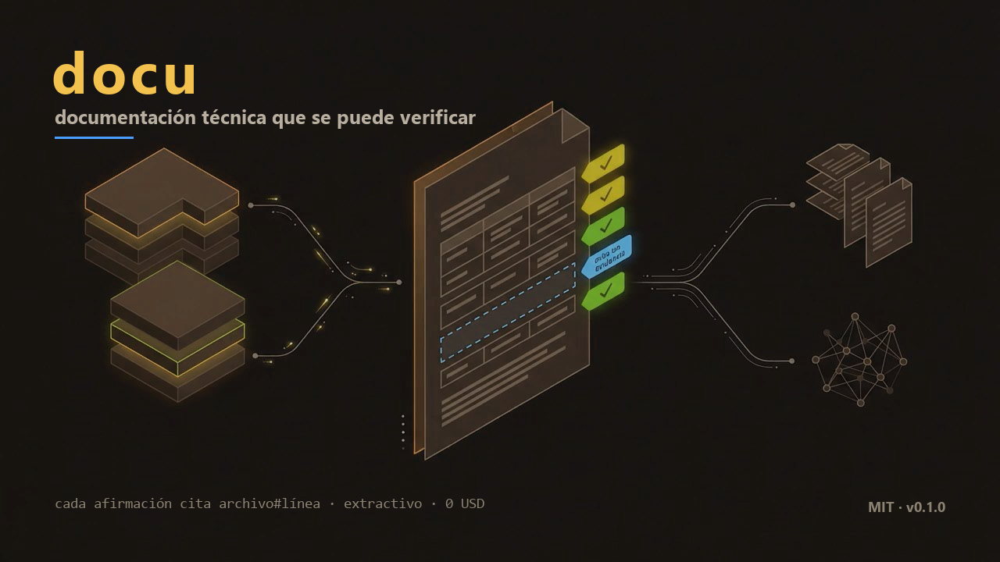

# docu

<p align="center">
  
</p>

<p align="center">
  <b>English</b> · <a href="README.es.md">Español</a>
</p>

[](https://github.com/CharlyZeta/Docu/actions/workflows/docu.yml)


**Technical documentation you can verify.** Every claim in the generated document links to the file
and line that supports it. If a citation cannot be opened and confirmed, the claim does not ship.

---

## The problem, in two sentences

A project's documentation goes stale faster than it gets written, and a newcomer cannot tell whether
what they are reading is still true. `docu` generates it from the code, cites every statement, and tells
you when it has gone out of date.

## What you get

- **A manual that cannot lie silently**: 100 % of rows carry a `file#line` citation. Whatever has no
  evidence is declared as a *gap* instead of being filled with plausible text.
- **Four different documents**, not four copies: technical manual, operations, a no-jargon guide, and
  onboarding.
- **Diagrams** for architecture, classes, API flow and data model, all generated from the same code.
- **A website** where any row can be drilled down to the real snippet of the file.
- **An MCP server** so your agent can query the code and the documentation with citations.
- **Maintenance**: when the code changes, the documentation is flagged as stale and CI can open a pull
  request with the update.
- **Delegated prose (optional)**: if you want a written introduction, `docu` hands the cited facts to
  *your* agent and **validates** what comes back — every sentence must reference existing facts and
  none may introduce new figures. No keys, no cost, and the model never decides what is true.

## How it works

```
   repository            cited facts             documents            query
 ┌──────────────┐      ┌──────────────────┐     ┌───────────────┐    ┌──────────────┐
 │ Java · Python│  ──► │ path#L10-L42     │ ──► │ L1 · L2 · L3  │───►│ .md files    │
 │ TypeScript   │      │ no citation→gap  │     │ L4 · diagrams │    │ web · MCP    │
 │ + PDF/web    │      └──────────────────┘     └───────────────┘    └──────────────┘
 └──────────────┘            ▲                        ▲
                    deterministic audit        quality gate
```

**It uses no language model.** It is deterministic: same code in, same document out, byte for byte. It
costs 0 USD and works offline.

## Start in three commands

```bash
docu init --root . --apply    # detect the stack and write the profile
docu gen --root .             # generate the levels, with citations
docu audit --root .           # five checks, one weighted score
```

Install: `uv tool install git+https://github.com/CharlyZeta/Docu` (or `pipx`, or `pip install -e .`).
It only requires Python 3.11+; the core has no dependencies.

### Updating an install

Installed as a tool, `docu` is a **frozen copy** from the day you installed it: new commands do not
appear on their own.

```bash
uv tool install --force git+https://github.com/CharlyZeta/Docu   # or: pipx reinstall docu
docu --version    # version, command count, and the path it runs from
```

If a command "does not exist", `docu --version` confirms it: fewer commands than the repository means a
stale binary. For development, `pip install -e .` reflects changes without reinstalling.

## What makes it different

| | An LLM writing docs | **docu** |
|---|---|---|
| Where the text comes from | the model | the repository |
| Can it be checked? | you have to trust it | you open the cited line |
| Does it invent what is missing? | yes, confidently | it declares the gap |
| Cost and repeatability | variable | 0 USD, always identical |
| Does it know when it went stale? | no | hash of six inputs |

## The four levels

| Level | Document | For whom |
|---|---|---|
| L1 | technical manual | engineering: architecture, diagrams, API, configuration, data model |
| L2 | operations and deployment | whoever runs the system: environment, ports, artifacts, CI |
| L3 | usage guide | business readers: what can be done, no jargon (a test forbids technical vocabulary) |
| L4 | onboarding | whoever is new |

The manual for this very repository is the most honest example:
[`docs/generated/l1-manual-tecnico.md`](docs/generated/l1-manual-tecnico.md). The real numbers are
there, each with its citation, instead of a number in a README.

## Diagrams and website

Diagrams (package architecture, classes, API flow and ERD) are generated from evidence and embedded in
L1. The ERD is trimmed to the entities with the most relations **and says so**: a diagram that silently
omits things lies like a stale table.

`docu site` publishes the same content in three steps — summary, detail, and **proof** (the citation and
the real snippet of the file) — with no CDN and no mandatory JavaScript: it works by opening
`index.html` from disk.

## MCP server

Compatible agents (Claude Code, Cursor, etc.) query the same documentation, **read-only**:

```json
{"mcpServers": {"docu": {"command": "docu",
  "args": ["serve", "--mcp", "--root", ".", "--out", "docs/generated"]}}}
```

Tools: `list_projects`, `search_code`, `search_docs`, `get_module`, `get_symbol_doc`,
`list_gaps`, `list_unsupported`, `get_architecture`, `get_freshness`, `verify_citation`, `get_diagram`.
Every response carries citations, and `verify_citation` returns the cited lines so you can check them.

## Corpus hygiene

The project's `.gitignore` is honoured (negation, directories, anchoring and `**`) plus a floor of
exclusions (`node_modules`, `target`, `dist`, `coverage`, `build`, `out`, `__pycache__`…). Whatever the
project declares as not-source is neither documented nor counted.

## Exit codes

| Code | Meaning |
|---|---|
| 0 | ok |
| 10 | no changes (`gen --incremental`, `pdf` with no PDFs) |
| 20 | review: gate in `REVIEW`, stale or missing pages, audit findings |
| 30 | budget exhausted |
| 40 | uncitable source (nothing documentable, no usable PDF) |
| 50 | not implemented |
| 60 | invalid profile |
| 70 | internal error |

Page states are `fresh`, `stale` (a source changed), `expired` (TTL passed) and **`missing`** (the
manifest declares it but the file is gone). `missing` is not freshness: `docu status` says so, suggests
`docu gen` and returns `"generated": false`. With no manifest there is no state to show: exit 10 and a
single line asking you to generate.

`docu status --why` names the files that invalidated freshness.

## Back to zero

```bash
docu clean                 # list what it would delete (simulation)
docu clean --force         # delete documents, diagrams, web, PDFs and state
docu clean --docs-only     # keep the manifest: the next run is incremental
docu clean --ledger        # delete the learning history too
```

It only deletes what `docu` generated: the documents it names (`l1-manual-tecnico.md`,
`l2-operacion.md`, `l3-guia-de-uso.md`, `l4-readme.md`), their artifact folders (`diagrams/`, `web/`,
`pdf/`, `site/`) and its state (`.docu/manifest.json`, `web.json`, `prose.json`). It **does not touch**
hand-written documentation — even when it shares the folder — the profile, or the ledger (unless
`--ledger`).

## Try it without touching your project

```bash
docu gen --root /path/to/project --out /outside/the/repo --dry-run   # writes nothing
docu gen --root /path/to/project --out /outside/the/repo \
         --manifest /outside/the/repo/.docu/manifest.json            # no manifest or ledger inside
```

A full recipe to hand to an agent: [`PROBAR-CON-OTRO-AGENTE.md`](PROBAR-CON-OTRO-AGENTE.md) (in Spanish).

## Declared limits

- **It does not write prose**: the document is made of fact tables.
- **It does not read scanned, encrypted or `ToUnicode`-less PDFs**; when it cannot, it says so.
- **It does not execute JavaScript**: a SPA served empty is declared "no useful text".
- **It does not invent foreign keys**: the ERD relates by declared field type.
- **It does not cover IaC** (Terraform/CloudFormation) or sequence diagrams.
- **Three languages**: Java, Python and TypeScript/JS; anything else is declared unsupported.

## Supported languages

| Language | Extracted |
|---|---|
| Java | types, members, fields, annotations, imports, Spring routes |
| Python | classes, functions, annotated attributes, decorators, FastAPI/Flask routes |
| TypeScript/JS | classes, interfaces, enums, properties, NestJS decorators, routes, `.mjs`/`.cjs` |

The [conformance suite](tests/test_conformance.py) requires the same 12 constructs across the three
languages without touching `core/`.

## Rule of this repository

**The README is updated in the same commit that changes capabilities, commands or numbers.** It is not
a promise: [`tests/test_readme.py`](tests/test_readme.py) fails if either README mentions a command that
does not exist, an MCP tool the server does not expose, an invented exit code, or a test count that does
not match. Both language versions are checked.

## Layout

```
src/docu/core/        contracts, ports, policy, profile   (pure stdlib, leaf of the graph)
src/docu/index/       chunker, freshness, packages, .gitignore, PDFs and web snapshots
src/docu/retrieve/    domain glossary, hybrid search and routing
src/docu/generate/    facts, diagrams, four levels, operations
src/docu/audit/       deterministic audit
src/docu/publish/     website with progressive disclosure and hand-written SVG
src/docu/conformance/ prescribed vs. real architecture
src/docu/learn/       ledger, patterns, promotion, federation
src/docu/delivery/    CLI, CI, profile proposal, MCP server
src/docu/adapters/    languages, embedders, sources (PDF, web)
eval/                 golden set, evaluation harness, reports
tests/                conformance, core, and the README guard
```

## Project docs

- [`Plan.md`](Plan.md) — phases F0–F7, later deliveries, next features and external feedback.
- [`Guia-v2.md`](Guia-v2.md) — corrected architecture (14 corrections over the original guide).
- [`EVALUACION.md`](EVALUACION.md) — weighted score against the initial idea and what moves it.
- [`eval/README.md`](eval/README.md) — retrieval measurements.

## Next features

Use the repository's existing documentation as cited evidence · index PDFs and web snapshots in the
search · prose with an LLM (optional) · IaC · sequence diagrams · pagination for large indexes. Detail
and cost in [`Plan.md`](Plan.md) §14.

## License

MIT. Federation between installs is opt-in and never sends code or text: only pattern fingerprints and
metrics.
