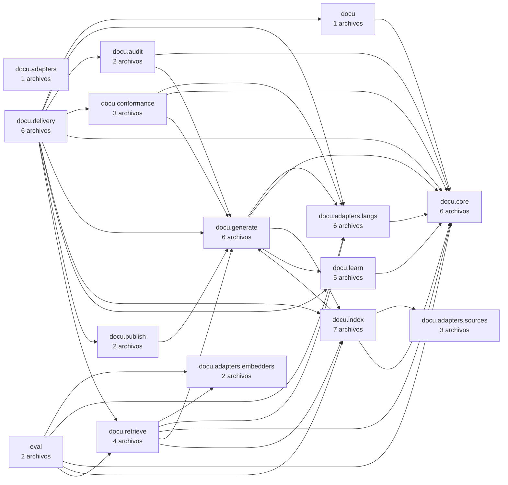
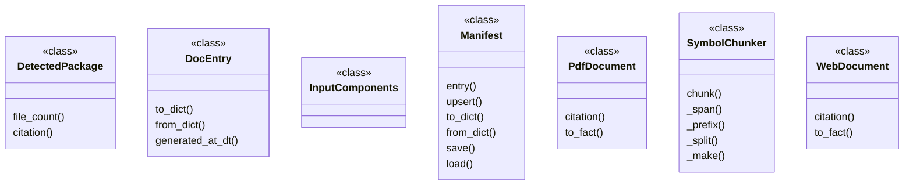
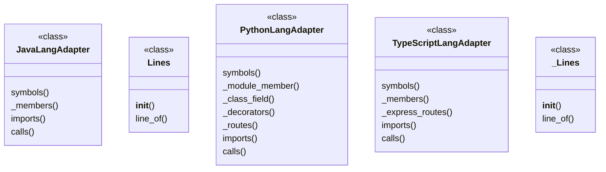

# docu — Manual técnico (Nivel 1)

Generado por `docu 0.1.0` · fuente `sha256:15336` · archivos: 60 · afirmaciones: 1024 · sin cita: 0

> Documento **extractivo**: cada fila procede de un archivo y un rango de líneas del repositorio. No hay texto generado sin evidencia.

## 1. Resumen

- Módulos de build: **0** · paquetes: **15**
- Dependencias declaradas: **16**
- Rutas HTTP: **0**
- Claves de configuración: **24**
- Tipos: **90** · métodos: **479**

## 2. Arquitectura: módulos y paquetes

| Paquete | Lenguaje | Archivos | Cita |
|---|---|---|---|
| `docu` | python | 1 | `src/docu/__init__.py#L1-L10` |
| `docu.adapters` | python | 1 | `src/docu/adapters/__init__.py#L1-L1` |
| `docu.adapters.embedders` | python | 2 | `src/docu/adapters/embedders/__init__.py#L1-L1` |
| `docu.adapters.langs` | python | 6 | `src/docu/adapters/langs/__init__.py#L1-L1` |
| `docu.adapters.sources` | python | 3 | `src/docu/adapters/sources/__init__.py#L1-L5` |
| `docu.audit` | python | 2 | `src/docu/audit/__init__.py#L1-L5` |
| `docu.conformance` | python | 3 | `src/docu/conformance/__init__.py#L1-L5` |
| `docu.core` | python | 6 | `src/docu/core/__init__.py#L1-L5` |
| `docu.delivery` | python | 6 | `src/docu/delivery/__init__.py#L1-L5` |
| `docu.generate` | python | 6 | `src/docu/generate/__init__.py#L1-L5` |
| `docu.index` | python | 7 | `src/docu/index/__init__.py#L1-L5` |
| `docu.learn` | python | 5 | `src/docu/learn/__init__.py#L1-L5` |
| `docu.publish` | python | 2 | `src/docu/publish/__init__.py#L1-L5` |
| `docu.retrieve` | python | 4 | `src/docu/retrieve/__init__.py#L1-L5` |
| `eval` | python | 2 | `eval/__init__.py#L1-L1` |

## 3. Diagramas

### Dependencias entre paquetes · 15 paquetes · 36 dependencias derivadas de imports

### Clases del paquete · 7 clases de docu.index

### Clases del paquete · 5 clases de docu.adapters.langs

### Clases del paquete · 18 clases de docu.core

```mermaid
classDiagram
    class Artifact <<class>> {
        __post_init__()
    }
    class Budget <<class>> {
        spend()
        exceeded()
        remaining_usd()
    }
    class BudgetExhausted <<class>> {
    }
    class Change <<class>> {
        kind()
        describe()
    }
    class Chunk <<class>> {
        __post_init__()
        citation()
        to_record()
    }
    class Chunker <<class>> {
        chunk()
    }
    class Claim <<class>> {
        verified()
    }
    class ContentNode <<class>> {
        unsupported()
        is_publishable()
    }
    class DocState <<class>> {
    }
    class Embedder <<class>> {
        embed()
    }
    class FreshnessRecord <<class>> {
        is_expired()
    }
    class GateDecision <<class>> {
        may_write()
        describe()
    }
    class GateOutcome <<class>> {
    }
    class GatePolicy <<class>> {
        evaluate()
    }
    class Judge <<class>> {
        score()
    }
    class LangAdapter <<class>> {
        symbols()
        imports()
        calls()
    }
    class Metrics <<class>> {
    }
    class Mode <<class>> {
    }
```

### modelo-de-datos · 73 entidades · 12 relaciones declaradas por tipo

```mermaid
erDiagram
    ArchitectureModel {
        tuple_DeclaredComponent components
        tuple_Route routes
        tuple_str sources
        str schema_version
    }
    Artifact {
        str artifact_id
        SourceKind kind
        str uri
        str content_hash
        datetime captured_at
        str lang
        str snapshot_path
        Mapping_str__Any metadata
        str schema_version
    }
    AuditReport {
        str project
        dict_str__Check checks
    }
    AutoIndex {
        Sequence_Segment segments
        object embedder
        SymbolIndex _symbols
        HybridIndex _hybrid
    }
    BM25 {
        float k1
        float b
        Sequence_Segment segments
        dict_str__int _df
        list_int _lengths
        float _avgdl
    }
    Budget {
        float max_cost_usd
        float max_seconds
        int max_pages
        int max_llm_calls
        float spent_usd
        float elapsed_s
        int pages_written
        int llm_calls
    }
    Candidate {
        Pattern pattern
        Sequence_str reasons
    }
    Case {
        str id
        str category
        str question
        tuple_Expected expected
        str answer
        str notes
        str query
    }
    CaseResult {
        str case_id
        str category
        float recall
        bool hit
        float mrr
        bool line_hit
        tuple_str retrieved
        float elapsed_ms
    }
    Change {
        str field
        object before
        object after
        str reason
        bool applied
    }
    Check {
        str name
        int total
        int failed
        tuple_str details
        str note
    }
    Chunk {
        str chunk_id
        str artifact_id
        SourceKind source_type
        str content
        str content_prefix
        str content_hash
        str file_path
        str lang
        str enclosing_symbol
        SymbolKind symbol_kind
        int line_start
        int line_end
    }
    Chunker {
        str name
    }
    Claim {
        str text
        Sequence_str evidence
    }
    CodeChunk {
        str path
        int start
        int end
        str text
        str symbol
        str kind
        tuple_str tokens
        tuple_str exact_names
    }
    CodeFacts {
        tuple_RouteFact routes
        Mapping_str__str components
        tuple_tuple_str__str dependencies
    }
    CodeIndex {
        list_CodeChunk chunks
        object embedder
        Mapping_str__Sequence_st glossary
        float k1
        float b
        dict_str__int _df
        list_int _lengths
        float _avgdl
        dict_str__list_CodeChunk _by_name
        list_Sequence_float _vectors
        bool _dense_ready
    }
    ContentNode {
        str node_id
        str kind
        str title
        list_Claim claims
        tuple_str levels
        DocState state
        float confidence
        dict_str__str rendered
        str schema_version
    }
    Decision {
        str action
        str pattern_id
        float delta
        Sequence_str reasons
    }
    DeclaredComponent {
        str name
        str kind
        tuple_Route provides
        tuple_str depends_on
        str source
    }
    DetectedPackage {
        str name
        str language
        tuple_str files
        str declaration
    }
    Diagram {
        str name
        str kind
        str mermaid
        str note
    }
    Discrepancy {
        str kind
        str subject
        str detail
        str code_citation
        str declaration_source
    }
    DocEntry {
        str level
        str path
        str input_hash
        str generated_at
        str content_hash
        int ttl_days
        Mapping_str__str sources
    }
    DocIndex {
        list_Section sections
        float k1
        float b
        Mapping_str__Sequence_st glossary
        dict_str__int _df
        float _avgdl
    }
    DriftReport {
        ArchitectureModel model
        list_Discrepancy discrepancies
        int routes_in_code
        int components_in_code
    }
    Embedder {
        str embedder_id
        int dim
    }
    Expected {
        str path
        str symbol
        tuple_int__int lines
        bool optional
    }
    Fact {
        str kind
        str subject
        str detail
        str citation
        Mapping_str__str attributes
    }
    FederationPayload {
        Mapping_str__object data
    }
    FreshnessRecord {
        str node_id
        str input_hash
        DocState state
        datetime generated_at
        int ttl_days
        str schema_version
    }
    GateDecision {
        GateOutcome outcome
        tuple_str reasons
    }
    GatePolicy {
        Thresholds thresholds
        bool require_zero_unsupported
        bool require_fresh
    }
    GeneratedDoc {
        str level
        Path path
        str content
    }
    GenerationResult {
        str project
        tuple_GeneratedDoc docs
        tuple_Fact facts
        Mapping_str__str sources
        Metrics metrics
        GateDecision gate
        float elapsed_s
        tuple_Fact unsupported
        Mapping_str__DocState states
        Path manifest_path
        Mapping_str__bool applicability
        Mapping_str__int unsupported_languages
    }
    HybridIndex {
        Sequence_Segment segments
        object embedder
        float k1
        float b
        int rrf_k
        int max_exact_per_file
        int max_per_file
        BM25 _bm25
        dict_str__list_Segment _by_name
        list_list_float _vectors
    }
    InputComponents {
        str source_content
        str deps_signature
        str template
        str embedder
        str chunker
        str profile
    }
    JavaLangAdapter {
        str language
        tuple_str file_globs
    }
    Judge {
        str judge_id
        float temperature
    }
    LangAdapter {
        str language
        Sequence_str file_globs
    }
    Manifest {
        str project
        list_DocEntry docs
        Mapping_str__str versions
        str schema_version
    }
    McpServer {
        Path root
        Path docs_dir
        Path manifest_path
        Path profile_path
        Path workspace
        bool dense
        dict_str__ProjectRef _refs
        dict_str__DocIndex _indexes
        dict_str__object _code_indexes
    }
    Metrics {
        float accuracy
        float completeness
        float attribution
        float conciseness
        float freshness
        float cost_usd
        int unsupported_claims
        str schema_version
    }
    OnnxEmbedder {
        Path model_dir
        str embedder_id
        int max_length
        int batch_size
        object _session
        object _tokenizer
        tuple_str _input_names
        int _dim
    }
    Page {
        str name
        str title
        str html
    }
    Pattern {
        str pattern_id
        str stack
        str kind
        Mapping_str__float metrics
        int runs
        str notes
    }
    PatternLibrary {
        dict_str__Pattern patterns
        list_dict_str__object history
        str version
        str schema_version
    }
    PdfDocument {
        str rel
        int pages
        int chars
        str method
        str status
        bool usable
        tuple_str warnings
    }
    PdfPage {
        int number
        str text
    }
    PdfText {
        tuple_PdfPage pages
        int total_pages
        int chars
        str method
        tuple_str warnings
    }
    Profile {
        str project
        Mode mode
        tuple_str levels
        str output_dir
        str language
        int ttl_days
        tuple_str include
        tuple_str exclude
        Thresholds thresholds
        Mapping_str__tuple_str glossary
        float promotion_delta
        float rollback_drop
    }
    ProjectRef {
        str name
        Path root
        Path docs_dir
    }
    Publisher {
        str publisher_id
    }
    PythonLangAdapter {
        str language
        tuple_str file_globs
    }
    RenderAdapter {
        str name
        str target
    }
    Report {
        str project
        int k
        int files
        int segments
        list_CaseResult results
        str query_field
        str index_mode
        bool query_expansion
        str generated_at
        str schema_version
    }
    Reranker {
        str reranker_id
    }
    ResolvedOptions {
        Profile profile
        str project
        tuple_str levels
        Path out_dir
        int ttl_days
        tuple_str include
        tuple_str exclude
        Thresholds thresholds
        Path manifest
    }
    Route {
        str verb
        str path
    }
    RouteFact {
        str key
        str citation
        str handler
    }
    RunRecord {
        str run_id
        str project
        str commit
        Mode mode
        datetime started_at
        datetime finished_at
        dict_str__str versions
        Metrics metrics
        GateDecision gate
        int pages_written
        int pages_skipped
        float cost_usd
    }
    Section {
        str document
        str heading
        str body
        str level
        tuple_str tokens
        tuple_str citations
    }
    Segment {
        str path
        int start
        int end
        str text
        tuple_str tokens
        tuple_str exact_names
        str citation
    }
    Snapshot {
        str url
        str text
        str sha
        str captured_at
        int status_code
    }
    SourceAdapter {
        str name
        type kind
    }
    Symbol {
        str name
        str qualname
        SymbolKind kind
        str path
        int line_start
        int line_end
        str signature
        Sequence__Symbol children
        Sequence_str annotations
        str schema_version
    }
    SymbolChunker {
        str name
        int max_tokens
        int overlap_tokens
    }
    SymbolIndex {
        Sequence_Segment segments
        float k1
        float b
        int rrf_k
        int max_exact_per_file
        int max_per_file
        BM25 _bm25
        dict_str__list_Segment _by_name
    }
    Thresholds {
        float accuracy
        float completeness
        float attribution
        float conciseness
    }
    TypeScriptLangAdapter {
        str language
        tuple_str file_globs
    }
    VectorStore {
        str store_id
    }
    WebDocument {
        str url
        str rel
        str sha
        str captured_at
        int lines
        int chars
        bool usable
        str error
    }
    _Handler {
        sinTipo server_version
        McpServer mcp
    }
    AutoIndex }o--|| SymbolIndex : "_symbols"
    AutoIndex }o--|| HybridIndex : "_hybrid"
    Candidate }o--|| Pattern : "pattern"
    DriftReport }o--|| ArchitectureModel : "model"
    GatePolicy }o--|| Thresholds : "thresholds"
    GenerationResult }o--|| Metrics : "metrics"
    GenerationResult }o--|| GateDecision : "gate"
    HybridIndex }o--|| BM25 : "_bm25"
    Profile }o--|| Thresholds : "thresholds"
    ResolvedOptions }o--|| Thresholds : "thresholds"
    SymbolIndex }o--|| BM25 : "_bm25"
    _Handler }o--|| McpServer : "mcp"
```

### Plataforma

| Elemento | Tipo | Valor | Cita |
|---|---|---|---|
| `requires-python` | propiedad | >=3.11 | `pyproject.toml#L10-L10` |

## 4. Dependencias

| Artefacto | Versión | Scope | Cita |
|---|---|---|---|
| `typer` | >=0.12 | cli | `pyproject.toml#L18-L18` |
| `PyYAML` | >=6.0 | profile | `pyproject.toml#L19-L19` |
| `tree-sitter` | >=0.23 | langs | `pyproject.toml#L20-L20` |
| `tree-sitter-python` | (sin versión fija) | langs | `pyproject.toml#L20-L20` |
| `tree-sitter-typescript` | (sin versión fija) | langs | `pyproject.toml#L20-L20` |
| `tree-sitter-java` | (sin versión fija) | langs | `pyproject.toml#L20-L20` |
| `chromadb` | >=0.5 | index | `pyproject.toml#L21-L21` |
| `onnxruntime` | >=1.18 | index | `pyproject.toml#L21-L21` |
| `tokenizers` | >=0.19 | index | `pyproject.toml#L21-L21` |
| `pdfplumber` | >=0.11 | docs | `pyproject.toml#L22-L22` |
| `markdown-it-py` | >=3.0 | docs | `pyproject.toml#L22-L22` |
| `jinja2` | >=3.1 | generate | `pyproject.toml#L23-L23` |
| `ragas` | >=0.1 | eval | `pyproject.toml#L24-L24` |
| `pytest` | >=8.0 | dev | `pyproject.toml#L25-L25` |
| `ruff` | >=0.6 | dev | `pyproject.toml#L25-L25` |
| `mypy` | >=1.10 | dev | `pyproject.toml#L25-L25` |

## 5. API HTTP

> **Sin evidencia disponible.** Esta sección no se documenta: el agente no rellena huecos con prosa plausible.

## 6. Configuración

| Clave | Valor | Cita |
|---|---|---|
| `schema_version` | `1.0` | `docu.profile.yaml#L3-L3` |
| `project` | `docu` | `docu.profile.yaml#L5-L5` |
| `mode` | `apply` | `docu.profile.yaml#L6-L6` |
| `sources.git.ref` | `HEAD` | `docu.profile.yaml#L10-L10` |
| `sources.pdf` | `[]` | `docu.profile.yaml#L31-L31` |
| `sources.web.allowlist` | `["docs.spring.io", "docs.python.org", "developer.mozilla.org"]` | `docu.profile.yaml#L33-L33` |
| `sources.contracts` | `[]` | `docu.profile.yaml#L34-L34` |
| `output.dir` | `docs/generated` | `docu.profile.yaml#L37-L37` |
| `output.language` | `es` | `docu.profile.yaml#L38-L38` |
| `output.levels.l1` | `true` | `docu.profile.yaml#L40-L40` |
| `output.levels.l2` | `true` | `docu.profile.yaml#L41-L41` |
| `output.levels.l3` | `false` | `docu.profile.yaml#L42-L42` |
| `output.levels.l4` | `true` | `docu.profile.yaml#L43-L43` |
| `output.notation.diagrams` | `mermaid` | `docu.profile.yaml#L45-L45` |
| `output.notation.architecture` | `c4` | `docu.profile.yaml#L46-L46` |
| `output.notation.api` | `openapi3.1` | `docu.profile.yaml#L47-L47` |
| `acceptance.thresholds.accuracy` | `8.5` | `docu.profile.yaml#L51-L51` |
| `acceptance.thresholds.completeness` | `9.0` | `docu.profile.yaml#L52-L52` |
| `acceptance.thresholds.attribution` | `9.5` | `docu.profile.yaml#L53-L53` |
| `acceptance.thresholds.conciseness` | `7.5` | `docu.profile.yaml#L54-L54` |
| `freshness.ttl_days` | `90` | `docu.profile.yaml#L57-L57` |
| `learn.promotion_delta` | `0.05` | `docu.profile.yaml#L60-L60` |
| `learn.rollback_drop` | `0.05` | `docu.profile.yaml#L61-L61` |
| `learn.federate` | `false` | `docu.profile.yaml#L62-L62` |

## 7. Tipos

| Tipo | Nombre | Anotaciones | Cita |
|---|---|---|---|
| class | `Segment` | `@dataclass` | `eval/harness.py#L118-L131` |
| class | `BM25` | `@dataclass` | `eval/harness.py#L262-L304` |
| class | `AutoIndex` | `@dataclass` | `eval/harness.py#L353-L373` |
| class | `HybridIndex` | `@dataclass` | `eval/harness.py#L377-L458` |
| class | `SymbolIndex` | `@dataclass` | `eval/harness.py#L462-L518` |
| class | `Expected` | `@dataclass` | `eval/harness.py#L525-L529` |
| class | `Case` | `@dataclass` | `eval/harness.py#L533-L550` |
| class | `CaseResult` | `@dataclass` | `eval/harness.py#L554-L562` |
| class | `Report` | `@dataclass` | `eval/harness.py#L566-L661` |
| class | `OnnxEmbedder` | `@dataclass` | `src/docu/adapters/embedders/onnx_local.py#L40-L104` |
| class | `Lines` | — | `src/docu/adapters/langs/_braces.py#L233-L250` |
| class | `_Lines` | — | `src/docu/adapters/langs/java.py#L145-L162` |
| class | `JavaLangAdapter` | `@dataclass` | `src/docu/adapters/langs/java.py#L367-L588` |
| class | `PythonLangAdapter` | `@dataclass` | `src/docu/adapters/langs/python.py#L19-L200` |
| class | `TypeScriptLangAdapter` | `@dataclass` | `src/docu/adapters/langs/typescript.py#L88-L424` |
| class | `PdfError` | — | `src/docu/adapters/sources/pdf.py#L36-L37` |
| class | `PdfPage` | `@dataclass` | `src/docu/adapters/sources/pdf.py#L121-L123` |
| class | `PdfText` | `@dataclass` | `src/docu/adapters/sources/pdf.py#L127-L147` |
| class | `WebError` | — | `src/docu/adapters/sources/web.py#L39-L40` |
| class | `Snapshot` | `@dataclass` | `src/docu/adapters/sources/web.py#L44-L63` |
| class | `_TextExtractor` | — | `src/docu/adapters/sources/web.py#L66-L102` |
| class | `Check` | `@dataclass` | `src/docu/audit/verify.py#L41-L69` |
| class | `AuditReport` | `@dataclass` | `src/docu/audit/verify.py#L73-L124` |
| class | `Discrepancy` | `@dataclass` | `src/docu/conformance/drift.py#L38-L62` |
| class | `DriftReport` | `@dataclass` | `src/docu/conformance/drift.py#L66-L118` |
| class | `RouteFact` | `@dataclass` | `src/docu/conformance/drift.py#L125-L130` |
| class | `CodeFacts` | `@dataclass` | `src/docu/conformance/drift.py#L134-L137` |
| class | `Route` | `@dataclass` | `src/docu/conformance/model.py#L31-L40` |
| class | `DeclaredComponent` | `@dataclass` | `src/docu/conformance/model.py#L44-L49` |
| class | `ArchitectureModel` | `@dataclass` | `src/docu/conformance/model.py#L53-L79` |
| class | `SourceKind` | — | `src/docu/core/contracts.py#L35-L42` |
| class | `SymbolKind` | — | `src/docu/core/contracts.py#L45-L57` |
| class | `DocState` | — | `src/docu/core/contracts.py#L60-L65` |
| class | `Mode` | — | `src/docu/core/contracts.py#L68-L73` |
| class | `GateOutcome` | — | `src/docu/core/contracts.py#L76-L81` |
| class | `Artifact` | `@dataclass` | `src/docu/core/contracts.py#L88-L111` |
| class | `Symbol` | `@dataclass` | `src/docu/core/contracts.py#L115-L131` |
| class | `Chunk` | `@dataclass` | `src/docu/core/contracts.py#L138-L193` |
| class | `Claim` | `@dataclass` | `src/docu/core/contracts.py#L200-L211` |
| class | `ContentNode` | `@dataclass` | `src/docu/core/contracts.py#L215-L237` |
| class | `Metrics` | `@dataclass` | `src/docu/core/contracts.py#L244-L254` |
| class | `GateDecision` | `@dataclass` | `src/docu/core/contracts.py#L258-L271` |
| class | `RunRecord` | `@dataclass` | `src/docu/core/contracts.py#L278-L322` |
| class | `FreshnessRecord` | `@dataclass` | `src/docu/core/contracts.py#L329-L341` |
| class | `BudgetExhausted` | — | `src/docu/core/policy.py#L15-L16` |
| class | `Thresholds` | `@dataclass` | `src/docu/core/policy.py#L20-L34` |
| class | `Budget` | `@dataclass` | `src/docu/core/policy.py#L38-L72` |
| class | `GatePolicy` | `@dataclass` | `src/docu/core/policy.py#L76-L104` |
| class | `SourceAdapter` | `@runtime_checkable` | `src/docu/core/ports.py#L18-L28` |
| class | `LangAdapter` | `@runtime_checkable` | `src/docu/core/ports.py#L32-L52` |
| class | `Chunker` | `@runtime_checkable` | `src/docu/core/ports.py#L56-L62` |
| class | `Embedder` | `@runtime_checkable` | `src/docu/core/ports.py#L69-L76` |
| class | `VectorStore` | `@runtime_checkable` | `src/docu/core/ports.py#L80-L94` |
| class | `Reranker` | `@runtime_checkable` | `src/docu/core/ports.py#L98-L104` |
| class | `RenderAdapter` | `@runtime_checkable` | `src/docu/core/ports.py#L111-L118` |
| class | `Judge` | `@runtime_checkable` | `src/docu/core/ports.py#L122-L129` |
| class | `Publisher` | `@runtime_checkable` | `src/docu/core/ports.py#L133-L145` |
| class | `ProfileError` | — | `src/docu/core/profile.py#L46-L47` |
| class | `Profile` | `@dataclass` | `src/docu/core/profile.py#L51-L107` |
| class | `Change` | `@dataclass` | `src/docu/core/profile.py#L318-L332` |
| class | `YamlError` | — | `src/docu/core/yamlmini.py#L14-L15` |
| class | `CliError` | — | `src/docu/delivery/cli.py#L182-L187` |
| class | `ResolvedOptions` | `@dataclass` | `src/docu/delivery/cli.py#L191-L202` |
| class | `ExitCode` | — | `src/docu/delivery/exit_codes.py#L8-L16` |
| class | `_Handler` | — | `src/docu/delivery/http_server.py#L26-L89` |
| class | `ProjectRef` | `@dataclass` | `src/docu/delivery/mcp_server.py#L122-L131` |
| class | `ToolError` | — | `src/docu/delivery/mcp_server.py#L134-L135` |
| class | `McpServer` | `@dataclass` | `src/docu/delivery/mcp_server.py#L139-L469` |
| class | `Diagram` | `@dataclass` | `src/docu/generate/diagrams.py#L39-L49` |
| class | `Fact` | `@dataclass` | `src/docu/generate/facts.py#L29-L44` |
| class | `GeneratedDoc` | `@dataclass` | `src/docu/generate/pipeline.py#L89-L92` |
| class | `GenerationResult` | `@dataclass` | `src/docu/generate/pipeline.py#L96-L120` |
| class | `SymbolChunker` | `@dataclass` | `src/docu/index/chunker.py#L46-L220` |
| class | `InputComponents` | `@dataclass` | `src/docu/index/freshness.py#L26-L34` |
| class | `DocEntry` | `@dataclass` | `src/docu/index/manifest.py#L33-L68` |
| class | `Manifest` | `@dataclass` | `src/docu/index/manifest.py#L72-L124` |
| class | `DetectedPackage` | `@dataclass` | `src/docu/index/packages.py#L22-L36` |
| class | `PdfDocument` | `@dataclass` | `src/docu/index/pdfdocs.py#L24-L50` |
| class | `WebDocument` | `@dataclass` | `src/docu/index/webdocs.py#L18-L45` |
| class | `FederationError` | — | `src/docu/learn/federation.py#L28-L29` |
| class | `FederationPayload` | `@dataclass` | `src/docu/learn/federation.py#L33-L37` |
| class | `Pattern` | `@dataclass` | `src/docu/learn/patterns.py#L25-L55` |
| class | `PatternLibrary` | `@dataclass` | `src/docu/learn/patterns.py#L59-L142` |
| class | `Candidate` | `@dataclass` | `src/docu/learn/patterns.py#L156-L164` |
| class | `Decision` | `@dataclass` | `src/docu/learn/promotion.py#L21-L33` |
| class | `Page` | `@dataclass` | `src/docu/publish/site.py#L124-L127` |
| class | `CodeChunk` | `@dataclass` | `src/docu/retrieve/hybrid.py#L33-L59` |
| class | `CodeIndex` | `@dataclass` | `src/docu/retrieve/hybrid.py#L113-L249` |
| class | `Section` | `@dataclass` | `src/docu/retrieve/search.py#L65-L86` |
| class | `DocIndex` | `@dataclass` | `src/docu/retrieve/search.py#L123-L193` |

## 8. Diccionario de datos

> Campos **declarados** en el código. El tipo es el que declara el lenguaje, no una inferencia: si aparece «sin tipo declarado», el campo no lo tiene.

| Entidad | Campo | Tipo declarado | Anotaciones | Cita |
|---|---|---|---|---|
| `Segment` | `path` | `str` | — | `eval/harness.py#L125-L125` |
| `Segment` | `start` | `int` | — | `eval/harness.py#L126-L126` |
| `Segment` | `end` | `int` | — | `eval/harness.py#L127-L127` |
| `Segment` | `text` | `str` | — | `eval/harness.py#L128-L128` |
| `Segment` | `tokens` | `tuple[str, ...]` | — | `eval/harness.py#L129-L129` |
| `Segment` | `exact_names` | `tuple[str, ...]` | — | `eval/harness.py#L130-L130` |
| `Segment` | `citation` | `str | None` | — | `eval/harness.py#L131-L131` |
| `BM25` | `k1` | `float` | — | `eval/harness.py#L265-L265` |
| `BM25` | `b` | `float` | — | `eval/harness.py#L266-L266` |
| `BM25` | `segments` | `Sequence[Segment]` | — | `eval/harness.py#L267-L267` |
| `BM25` | `_df` | `dict[str, int]` | — | `eval/harness.py#L268-L268` |
| `BM25` | `_lengths` | `list[int]` | — | `eval/harness.py#L269-L269` |
| `BM25` | `_avgdl` | `float` | — | `eval/harness.py#L270-L270` |
| `AutoIndex` | `segments` | `Sequence[Segment]` | — | `eval/harness.py#L361-L361` |
| `AutoIndex` | `embedder` | `object` | — | `eval/harness.py#L362-L362` |
| `AutoIndex` | `_symbols` | `SymbolIndex` | — | `eval/harness.py#L363-L363` |
| `AutoIndex` | `_hybrid` | `HybridIndex` | — | `eval/harness.py#L364-L364` |
| `HybridIndex` | `segments` | `Sequence[Segment]` | — | `eval/harness.py#L384-L384` |
| `HybridIndex` | `embedder` | `object` | — | `eval/harness.py#L385-L385` |
| `HybridIndex` | `k1` | `float` | — | `eval/harness.py#L386-L386` |
| `HybridIndex` | `b` | `float` | — | `eval/harness.py#L387-L387` |
| `HybridIndex` | `rrf_k` | `int` | — | `eval/harness.py#L388-L388` |
| `HybridIndex` | `max_exact_per_file` | `int` | — | `eval/harness.py#L389-L389` |
| `HybridIndex` | `max_per_file` | `int` | — | `eval/harness.py#L390-L390` |
| `HybridIndex` | `_bm25` | `BM25` | — | `eval/harness.py#L391-L391` |
| `HybridIndex` | `_by_name` | `dict[str, list[Segment]]` | — | `eval/harness.py#L392-L392` |
| `HybridIndex` | `_vectors` | `list[list[float]]` | — | `eval/harness.py#L393-L393` |
| `SymbolIndex` | `segments` | `Sequence[Segment]` | — | `eval/harness.py#L472-L472` |
| `SymbolIndex` | `k1` | `float` | — | `eval/harness.py#L473-L473` |
| `SymbolIndex` | `b` | `float` | — | `eval/harness.py#L474-L474` |
| `SymbolIndex` | `rrf_k` | `int` | — | `eval/harness.py#L475-L475` |
| `SymbolIndex` | `max_exact_per_file` | `int` | — | `eval/harness.py#L476-L476` |
| `SymbolIndex` | `max_per_file` | `int` | — | `eval/harness.py#L477-L477` |
| `SymbolIndex` | `_bm25` | `BM25` | — | `eval/harness.py#L478-L478` |
| `SymbolIndex` | `_by_name` | `dict[str, list[Segment]]` | — | `eval/harness.py#L479-L479` |
| `Expected` | `path` | `str` | — | `eval/harness.py#L526-L526` |
| `Expected` | `symbol` | `str | None` | — | `eval/harness.py#L527-L527` |
| `Expected` | `lines` | `tuple[int, int] | None` | — | `eval/harness.py#L528-L528` |
| `Expected` | `optional` | `bool` | — | `eval/harness.py#L529-L529` |
| `Case` | `id` | `str` | — | `eval/harness.py#L534-L534` |
| `Case` | `category` | `str` | — | `eval/harness.py#L535-L535` |
| `Case` | `question` | `str` | — | `eval/harness.py#L536-L536` |
| `Case` | `expected` | `tuple[Expected, ...]` | — | `eval/harness.py#L537-L537` |
| `Case` | `answer` | `str` | — | `eval/harness.py#L538-L538` |
| `Case` | `notes` | `str` | — | `eval/harness.py#L539-L539` |
| `Case` | `query` | `str` | — | `eval/harness.py#L540-L540` |
| `CaseResult` | `case_id` | `str` | — | `eval/harness.py#L555-L555` |
| `CaseResult` | `category` | `str` | — | `eval/harness.py#L556-L556` |
| `CaseResult` | `recall` | `float` | — | `eval/harness.py#L557-L557` |
| `CaseResult` | `hit` | `bool` | — | `eval/harness.py#L558-L558` |
| `CaseResult` | `mrr` | `float` | — | `eval/harness.py#L559-L559` |
| `CaseResult` | `line_hit` | `bool | None` | — | `eval/harness.py#L560-L560` |
| `CaseResult` | `retrieved` | `tuple[str, ...]` | — | `eval/harness.py#L561-L561` |
| `CaseResult` | `elapsed_ms` | `float` | — | `eval/harness.py#L562-L562` |
| `Report` | `project` | `str` | — | `eval/harness.py#L567-L567` |
| `Report` | `k` | `int` | — | `eval/harness.py#L568-L568` |
| `Report` | `files` | `int` | — | `eval/harness.py#L569-L569` |
| `Report` | `segments` | `int` | — | `eval/harness.py#L570-L570` |
| `Report` | `results` | `list[CaseResult]` | — | `eval/harness.py#L571-L571` |
| `Report` | `query_field` | `str` | — | `eval/harness.py#L572-L572` |
| `Report` | `index_mode` | `str` | — | `eval/harness.py#L573-L573` |
| `Report` | `query_expansion` | `bool` | — | `eval/harness.py#L574-L574` |
| `Report` | `generated_at` | `str` | — | `eval/harness.py#L575-L575` |
| `Report` | `schema_version` | `str` | — | `eval/harness.py#L576-L576` |
| `OnnxEmbedder` | `model_dir` | `Path | str` | — | `src/docu/adapters/embedders/onnx_local.py#L43-L43` |
| `OnnxEmbedder` | `embedder_id` | `str` | — | `src/docu/adapters/embedders/onnx_local.py#L44-L44` |
| `OnnxEmbedder` | `max_length` | `int` | — | `src/docu/adapters/embedders/onnx_local.py#L45-L45` |
| `OnnxEmbedder` | `batch_size` | `int` | — | `src/docu/adapters/embedders/onnx_local.py#L46-L46` |
| `OnnxEmbedder` | `_session` | `object | None` | — | `src/docu/adapters/embedders/onnx_local.py#L47-L47` |
| `OnnxEmbedder` | `_tokenizer` | `object | None` | — | `src/docu/adapters/embedders/onnx_local.py#L48-L48` |
| `OnnxEmbedder` | `_input_names` | `tuple[str, ...]` | — | `src/docu/adapters/embedders/onnx_local.py#L49-L49` |
| `OnnxEmbedder` | `_dim` | `int` | — | `src/docu/adapters/embedders/onnx_local.py#L50-L50` |
| `JavaLangAdapter` | `language` | `str` | — | `src/docu/adapters/langs/java.py#L370-L370` |
| `JavaLangAdapter` | `file_globs` | `tuple[str, ...]` | — | `src/docu/adapters/langs/java.py#L371-L371` |
| `PythonLangAdapter` | `language` | `str` | — | `src/docu/adapters/langs/python.py#L22-L22` |
| `PythonLangAdapter` | `file_globs` | `tuple[str, ...]` | — | `src/docu/adapters/langs/python.py#L23-L23` |
| `TypeScriptLangAdapter` | `language` | `str` | — | `src/docu/adapters/langs/typescript.py#L89-L89` |
| `TypeScriptLangAdapter` | `file_globs` | `tuple[str, ...]` | — | `src/docu/adapters/langs/typescript.py#L90-L90` |
| `PdfPage` | `number` | `int` | — | `src/docu/adapters/sources/pdf.py#L122-L122` |
| `PdfPage` | `text` | `str` | — | `src/docu/adapters/sources/pdf.py#L123-L123` |
| `PdfText` | `pages` | `tuple[PdfPage, ...]` | — | `src/docu/adapters/sources/pdf.py#L128-L128` |
| `PdfText` | `total_pages` | `int` | — | `src/docu/adapters/sources/pdf.py#L129-L129` |
| `PdfText` | `chars` | `int` | — | `src/docu/adapters/sources/pdf.py#L130-L130` |
| `PdfText` | `method` | `str` | — | `src/docu/adapters/sources/pdf.py#L131-L131` |
| `PdfText` | `warnings` | `tuple[str, ...]` | — | `src/docu/adapters/sources/pdf.py#L132-L132` |
| `Snapshot` | `url` | `str` | — | `src/docu/adapters/sources/web.py#L45-L45` |
| `Snapshot` | `text` | `str` | — | `src/docu/adapters/sources/web.py#L46-L46` |
| `Snapshot` | `sha` | `str` | — | `src/docu/adapters/sources/web.py#L47-L47` |
| `Snapshot` | `captured_at` | `str` | — | `src/docu/adapters/sources/web.py#L48-L48` |
| `Snapshot` | `status_code` | `int` | — | `src/docu/adapters/sources/web.py#L49-L49` |
| `Check` | `name` | `str` | — | `src/docu/audit/verify.py#L44-L44` |
| `Check` | `total` | `int` | — | `src/docu/audit/verify.py#L45-L45` |
| `Check` | `failed` | `int` | — | `src/docu/audit/verify.py#L46-L46` |
| `Check` | `details` | `tuple[str, ...]` | — | `src/docu/audit/verify.py#L47-L47` |
| `Check` | `note` | `str` | — | `src/docu/audit/verify.py#L48-L48` |
| `AuditReport` | `project` | `str` | — | `src/docu/audit/verify.py#L74-L74` |
| `AuditReport` | `checks` | `dict[str, Check]` | — | `src/docu/audit/verify.py#L75-L75` |
| `Discrepancy` | `kind` | `str` | — | `src/docu/conformance/drift.py#L39-L39` |
| `Discrepancy` | `subject` | `str` | — | `src/docu/conformance/drift.py#L40-L40` |
| `Discrepancy` | `detail` | `str` | — | `src/docu/conformance/drift.py#L41-L41` |
| `Discrepancy` | `code_citation` | `str | None` | — | `src/docu/conformance/drift.py#L42-L42` |
| `Discrepancy` | `declaration_source` | `str | None` | — | `src/docu/conformance/drift.py#L43-L43` |
| `DriftReport` | `model` | `ArchitectureModel` | — | `src/docu/conformance/drift.py#L67-L67` |
| `DriftReport` | `discrepancies` | `list[Discrepancy]` | — | `src/docu/conformance/drift.py#L68-L68` |
| `DriftReport` | `routes_in_code` | `int` | — | `src/docu/conformance/drift.py#L69-L69` |
| `DriftReport` | `components_in_code` | `int` | — | `src/docu/conformance/drift.py#L70-L70` |
| `RouteFact` | `key` | `str` | — | `src/docu/conformance/drift.py#L128-L128` |
| `RouteFact` | `citation` | `str` | — | `src/docu/conformance/drift.py#L129-L129` |
| `RouteFact` | `handler` | `str` | — | `src/docu/conformance/drift.py#L130-L130` |
| `CodeFacts` | `routes` | `tuple[RouteFact, ...]` | — | `src/docu/conformance/drift.py#L135-L135` |
| `CodeFacts` | `components` | `Mapping[str, str]` | — | `src/docu/conformance/drift.py#L136-L136` |
| `CodeFacts` | `dependencies` | `tuple[tuple[str, str], ...]` | — | `src/docu/conformance/drift.py#L137-L137` |
| `Route` | `verb` | `str` | — | `src/docu/conformance/model.py#L32-L32` |
| `Route` | `path` | `str` | — | `src/docu/conformance/model.py#L33-L33` |
| `DeclaredComponent` | `name` | `str` | — | `src/docu/conformance/model.py#L45-L45` |
| `DeclaredComponent` | `kind` | `str` | — | `src/docu/conformance/model.py#L46-L46` |
| `DeclaredComponent` | `provides` | `tuple[Route, ...]` | — | `src/docu/conformance/model.py#L47-L47` |
| `DeclaredComponent` | `depends_on` | `tuple[str, ...]` | — | `src/docu/conformance/model.py#L48-L48` |
| `DeclaredComponent` | `source` | `str` | — | `src/docu/conformance/model.py#L49-L49` |
| `ArchitectureModel` | `components` | `tuple[DeclaredComponent, ...]` | — | `src/docu/conformance/model.py#L54-L54` |
| `ArchitectureModel` | `routes` | `tuple[Route, ...]` | — | `src/docu/conformance/model.py#L55-L55` |
| `ArchitectureModel` | `sources` | `tuple[str, ...]` | — | `src/docu/conformance/model.py#L56-L56` |
| `ArchitectureModel` | `schema_version` | `str` | — | `src/docu/conformance/model.py#L57-L57` |
| `Artifact` | `artifact_id` | `str` | — | `src/docu/core/contracts.py#L95-L95` |
| `Artifact` | `kind` | `SourceKind` | — | `src/docu/core/contracts.py#L96-L96` |
| `Artifact` | `uri` | `str` | — | `src/docu/core/contracts.py#L97-L97` |
| `Artifact` | `content_hash` | `str` | — | `src/docu/core/contracts.py#L98-L98` |
| `Artifact` | `captured_at` | `datetime` | — | `src/docu/core/contracts.py#L99-L99` |
| `Artifact` | `lang` | `str | None` | — | `src/docu/core/contracts.py#L100-L100` |
| `Artifact` | `snapshot_path` | `str | None` | — | `src/docu/core/contracts.py#L101-L101` |
| `Artifact` | `metadata` | `Mapping[str, Any]` | — | `src/docu/core/contracts.py#L102-L102` |
| `Artifact` | `schema_version` | `str` | — | `src/docu/core/contracts.py#L103-L103` |
| `Symbol` | `name` | `str` | — | `src/docu/core/contracts.py#L118-L118` |
| `Symbol` | `qualname` | `str` | — | `src/docu/core/contracts.py#L119-L119` |
| `Symbol` | `kind` | `SymbolKind` | — | `src/docu/core/contracts.py#L120-L120` |
| `Symbol` | `path` | `str` | — | `src/docu/core/contracts.py#L121-L121` |
| `Symbol` | `line_start` | `int` | — | `src/docu/core/contracts.py#L122-L122` |
| `Symbol` | `line_end` | `int` | — | `src/docu/core/contracts.py#L123-L123` |
| `Symbol` | `signature` | `str | None` | — | `src/docu/core/contracts.py#L124-L124` |
| `Symbol` | `children` | `Sequence['Symbol']` | — | `src/docu/core/contracts.py#L125-L125` |
| `Symbol` | `annotations` | `Sequence[str]` | — | `src/docu/core/contracts.py#L126-L126` |
| `Symbol` | `schema_version` | `str` | — | `src/docu/core/contracts.py#L127-L127` |
| `Chunk` | `chunk_id` | `str` | — | `src/docu/core/contracts.py#L141-L141` |
| `Chunk` | `artifact_id` | `str` | — | `src/docu/core/contracts.py#L142-L142` |
| `Chunk` | `source_type` | `SourceKind` | — | `src/docu/core/contracts.py#L143-L143` |
| `Chunk` | `content` | `str` | — | `src/docu/core/contracts.py#L144-L144` |
| `Chunk` | `content_prefix` | `str` | — | `src/docu/core/contracts.py#L145-L145` |
| `Chunk` | `content_hash` | `str` | — | `src/docu/core/contracts.py#L146-L146` |
| `Chunk` | `file_path` | `str` | — | `src/docu/core/contracts.py#L147-L147` |
| `Chunk` | `lang` | `str | None` | — | `src/docu/core/contracts.py#L148-L148` |
| `Chunk` | `enclosing_symbol` | `str | None` | — | `src/docu/core/contracts.py#L149-L149` |
| `Chunk` | `symbol_kind` | `SymbolKind` | — | `src/docu/core/contracts.py#L150-L150` |
| `Chunk` | `line_start` | `int` | — | `src/docu/core/contracts.py#L151-L151` |
| `Chunk` | `line_end` | `int` | — | `src/docu/core/contracts.py#L152-L152` |
| `Chunk` | `ingested_at` | `datetime` | — | `src/docu/core/contracts.py#L153-L153` |
| `Chunk` | `repo` | `str | None` | — | `src/docu/core/contracts.py#L154-L154` |
| `Chunk` | `commit` | `str | None` | — | `src/docu/core/contracts.py#L155-L155` |
| `Chunk` | `dependencies` | `Sequence[str]` | — | `src/docu/core/contracts.py#L156-L156` |
| `Chunk` | `embed_model` | `str | None` | — | `src/docu/core/contracts.py#L157-L157` |
| `Chunk` | `chunker` | `str` | — | `src/docu/core/contracts.py#L158-L158` |
| `Chunk` | `schema_version` | `str` | — | `src/docu/core/contracts.py#L159-L159` |
| `Claim` | `text` | `str` | — | `src/docu/core/contracts.py#L206-L206` |
| `Claim` | `evidence` | `Sequence[str]` | — | `src/docu/core/contracts.py#L207-L207` |
| `ContentNode` | `node_id` | `str` | — | `src/docu/core/contracts.py#L222-L222` |
| `ContentNode` | `kind` | `str` | — | `src/docu/core/contracts.py#L223-L223` |
| `ContentNode` | `title` | `str` | — | `src/docu/core/contracts.py#L224-L224` |
| `ContentNode` | `claims` | `list[Claim]` | — | `src/docu/core/contracts.py#L225-L225` |
| `ContentNode` | `levels` | `tuple[str, ...]` | — | `src/docu/core/contracts.py#L226-L226` |
| `ContentNode` | `state` | `DocState` | — | `src/docu/core/contracts.py#L227-L227` |
| `ContentNode` | `confidence` | `float` | — | `src/docu/core/contracts.py#L228-L228` |
| `ContentNode` | `rendered` | `dict[str, str]` | — | `src/docu/core/contracts.py#L229-L229` |
| `ContentNode` | `schema_version` | `str` | — | `src/docu/core/contracts.py#L230-L230` |
| `Metrics` | `accuracy` | `float` | — | `src/docu/core/contracts.py#L247-L247` |
| `Metrics` | `completeness` | `float` | — | `src/docu/core/contracts.py#L248-L248` |
| `Metrics` | `attribution` | `float` | — | `src/docu/core/contracts.py#L249-L249` |
| `Metrics` | `conciseness` | `float` | — | `src/docu/core/contracts.py#L250-L250` |
| `Metrics` | `freshness` | `float` | — | `src/docu/core/contracts.py#L251-L251` |
| `Metrics` | `cost_usd` | `float` | — | `src/docu/core/contracts.py#L252-L252` |
| `Metrics` | `unsupported_claims` | `int` | — | `src/docu/core/contracts.py#L253-L253` |
| `Metrics` | `schema_version` | `str` | — | `src/docu/core/contracts.py#L254-L254` |
| `GateDecision` | `outcome` | `GateOutcome` | — | `src/docu/core/contracts.py#L261-L261` |
| `GateDecision` | `reasons` | `tuple[str, ...]` | — | `src/docu/core/contracts.py#L262-L262` |
| `RunRecord` | `run_id` | `str` | — | `src/docu/core/contracts.py#L281-L281` |
| `RunRecord` | `project` | `str` | — | `src/docu/core/contracts.py#L282-L282` |
| `RunRecord` | `commit` | `str | None` | — | `src/docu/core/contracts.py#L283-L283` |
| `RunRecord` | `mode` | `Mode` | — | `src/docu/core/contracts.py#L284-L284` |
| `RunRecord` | `started_at` | `datetime` | — | `src/docu/core/contracts.py#L285-L285` |
| `RunRecord` | `finished_at` | `datetime | None` | — | `src/docu/core/contracts.py#L286-L286` |
| `RunRecord` | `versions` | `dict[str, str]` | — | `src/docu/core/contracts.py#L287-L287` |
| `RunRecord` | `metrics` | `Metrics | None` | — | `src/docu/core/contracts.py#L288-L288` |
| `RunRecord` | `gate` | `GateDecision | None` | — | `src/docu/core/contracts.py#L289-L289` |
| `RunRecord` | `pages_written` | `int` | — | `src/docu/core/contracts.py#L290-L290` |
| `RunRecord` | `pages_skipped` | `int` | — | `src/docu/core/contracts.py#L291-L291` |
| `RunRecord` | `cost_usd` | `float` | — | `src/docu/core/contracts.py#L292-L292` |
| `RunRecord` | `errors` | `list[str]` | — | `src/docu/core/contracts.py#L293-L293` |
| `RunRecord` | `schema_version` | `str` | — | `src/docu/core/contracts.py#L294-L294` |
| `FreshnessRecord` | `node_id` | `str` | — | `src/docu/core/contracts.py#L332-L332` |
| `FreshnessRecord` | `input_hash` | `str` | — | `src/docu/core/contracts.py#L333-L333` |
| `FreshnessRecord` | `state` | `DocState` | — | `src/docu/core/contracts.py#L334-L334` |
| `FreshnessRecord` | `generated_at` | `datetime` | — | `src/docu/core/contracts.py#L335-L335` |
| `FreshnessRecord` | `ttl_days` | `int` | — | `src/docu/core/contracts.py#L336-L336` |
| `FreshnessRecord` | `schema_version` | `str` | — | `src/docu/core/contracts.py#L337-L337` |
| `Thresholds` | `accuracy` | `float` | — | `src/docu/core/policy.py#L23-L23` |
| `Thresholds` | `completeness` | `float` | — | `src/docu/core/policy.py#L24-L24` |
| `Thresholds` | `attribution` | `float` | — | `src/docu/core/policy.py#L25-L25` |
| `Thresholds` | `conciseness` | `float` | — | `src/docu/core/policy.py#L26-L26` |
| `Budget` | `max_cost_usd` | `float` | — | `src/docu/core/policy.py#L41-L41` |
| `Budget` | `max_seconds` | `float` | — | `src/docu/core/policy.py#L42-L42` |
| `Budget` | `max_pages` | `int` | — | `src/docu/core/policy.py#L43-L43` |
| `Budget` | `max_llm_calls` | `int` | — | `src/docu/core/policy.py#L44-L44` |
| `Budget` | `spent_usd` | `float` | — | `src/docu/core/policy.py#L45-L45` |
| `Budget` | `elapsed_s` | `float` | — | `src/docu/core/policy.py#L46-L46` |
| `Budget` | `pages_written` | `int` | — | `src/docu/core/policy.py#L47-L47` |
| `Budget` | `llm_calls` | `int` | — | `src/docu/core/policy.py#L48-L48` |
| `GatePolicy` | `thresholds` | `Thresholds` | — | `src/docu/core/policy.py#L79-L79` |
| `GatePolicy` | `require_zero_unsupported` | `bool` | — | `src/docu/core/policy.py#L80-L80` |
| `GatePolicy` | `require_fresh` | `bool` | — | `src/docu/core/policy.py#L81-L81` |
| `SourceAdapter` | `name` | `str` | — | `src/docu/core/ports.py#L21-L21` |
| `SourceAdapter` | `kind` | `type` | — | `src/docu/core/ports.py#L22-L22` |
| `LangAdapter` | `language` | `str` | — | `src/docu/core/ports.py#L38-L38` |
| `LangAdapter` | `file_globs` | `Sequence[str]` | — | `src/docu/core/ports.py#L39-L39` |
| `Chunker` | `name` | `str` | — | `src/docu/core/ports.py#L59-L59` |
| `Embedder` | `embedder_id` | `str` | — | `src/docu/core/ports.py#L72-L72` |
| `Embedder` | `dim` | `int` | — | `src/docu/core/ports.py#L73-L73` |
| `VectorStore` | `store_id` | `str` | — | `src/docu/core/ports.py#L83-L83` |
| `Reranker` | `reranker_id` | `str` | — | `src/docu/core/ports.py#L101-L101` |
| `RenderAdapter` | `name` | `str` | — | `src/docu/core/ports.py#L114-L114` |
| `RenderAdapter` | `target` | `str` | — | `src/docu/core/ports.py#L115-L115` |
| `Judge` | `judge_id` | `str` | — | `src/docu/core/ports.py#L125-L125` |
| `Judge` | `temperature` | `float` | — | `src/docu/core/ports.py#L126-L126` |
| `Publisher` | `publisher_id` | `str` | — | `src/docu/core/ports.py#L136-L136` |
| `Profile` | `project` | `str` | — | `src/docu/core/profile.py#L54-L54` |
| `Profile` | `mode` | `Mode` | — | `src/docu/core/profile.py#L55-L55` |
| `Profile` | `levels` | `tuple[str, ...]` | — | `src/docu/core/profile.py#L56-L56` |
| `Profile` | `output_dir` | `str` | — | `src/docu/core/profile.py#L57-L57` |
| `Profile` | `language` | `str` | — | `src/docu/core/profile.py#L58-L58` |
| `Profile` | `ttl_days` | `int` | — | `src/docu/core/profile.py#L59-L59` |
| `Profile` | `include` | `tuple[str, ...]` | — | `src/docu/core/profile.py#L60-L60` |
| `Profile` | `exclude` | `tuple[str, ...]` | — | `src/docu/core/profile.py#L61-L61` |
| `Profile` | `thresholds` | `Thresholds` | — | `src/docu/core/profile.py#L62-L62` |
| `Profile` | `glossary` | `Mapping[str, tuple[str, ...]]` | — | `src/docu/core/profile.py#L63-L63` |
| `Profile` | `promotion_delta` | `float` | — | `src/docu/core/profile.py#L64-L64` |
| `Profile` | `rollback_drop` | `float` | — | `src/docu/core/profile.py#L65-L65` |
| `Profile` | `federate` | `bool` | — | `src/docu/core/profile.py#L66-L66` |
| `Profile` | `web_allowlist` | `tuple[str, ...]` | — | `src/docu/core/profile.py#L67-L67` |
| `Profile` | `web_urls` | `tuple[str, ...]` | — | `src/docu/core/profile.py#L68-L68` |
| `Profile` | `path` | `Path | None` | — | `src/docu/core/profile.py#L69-L69` |
| `Profile` | `raw` | `Mapping[str, object]` | — | `src/docu/core/profile.py#L70-L70` |
| `Change` | `field` | `str` | — | `src/docu/core/profile.py#L321-L321` |
| `Change` | `before` | `object` | — | `src/docu/core/profile.py#L322-L322` |
| `Change` | `after` | `object` | — | `src/docu/core/profile.py#L323-L323` |
| `Change` | `reason` | `str` | — | `src/docu/core/profile.py#L324-L324` |
| `Change` | `applied` | `bool` | — | `src/docu/core/profile.py#L325-L325` |
| `ResolvedOptions` | `profile` | `Profile | None` | — | `src/docu/delivery/cli.py#L194-L194` |
| `ResolvedOptions` | `project` | `str` | — | `src/docu/delivery/cli.py#L195-L195` |
| `ResolvedOptions` | `levels` | `tuple[str, ...]` | — | `src/docu/delivery/cli.py#L196-L196` |
| `ResolvedOptions` | `out_dir` | `Path` | — | `src/docu/delivery/cli.py#L197-L197` |
| `ResolvedOptions` | `ttl_days` | `int` | — | `src/docu/delivery/cli.py#L198-L198` |
| `ResolvedOptions` | `include` | `tuple[str, ...]` | — | `src/docu/delivery/cli.py#L199-L199` |
| `ResolvedOptions` | `exclude` | `tuple[str, ...]` | — | `src/docu/delivery/cli.py#L200-L200` |
| `ResolvedOptions` | `thresholds` | `Thresholds` | — | `src/docu/delivery/cli.py#L201-L201` |
| `ResolvedOptions` | `manifest` | `Path | None` | — | `src/docu/delivery/cli.py#L202-L202` |
| `_Handler` | `server_version` | `sin tipo declarado` | — | `src/docu/delivery/http_server.py#L27-L27` |
| `_Handler` | `mcp` | `McpServer` | — | `src/docu/delivery/http_server.py#L28-L28` |
| `ProjectRef` | `name` | `str` | — | `src/docu/delivery/mcp_server.py#L125-L125` |
| `ProjectRef` | `root` | `Path` | — | `src/docu/delivery/mcp_server.py#L126-L126` |
| `ProjectRef` | `docs_dir` | `Path` | — | `src/docu/delivery/mcp_server.py#L127-L127` |
| `McpServer` | `root` | `Path` | — | `src/docu/delivery/mcp_server.py#L147-L147` |
| `McpServer` | `docs_dir` | `Path` | — | `src/docu/delivery/mcp_server.py#L148-L148` |
| `McpServer` | `manifest_path` | `Path | None` | — | `src/docu/delivery/mcp_server.py#L149-L149` |
| `McpServer` | `profile_path` | `Path | None` | — | `src/docu/delivery/mcp_server.py#L150-L150` |
| `McpServer` | `workspace` | `Path | None` | — | `src/docu/delivery/mcp_server.py#L151-L151` |
| `McpServer` | `dense` | `bool` | — | `src/docu/delivery/mcp_server.py#L152-L152` |
| `McpServer` | `_refs` | `dict[str, ProjectRef]` | — | `src/docu/delivery/mcp_server.py#L153-L153` |
| `McpServer` | `_indexes` | `dict[str, DocIndex]` | — | `src/docu/delivery/mcp_server.py#L154-L154` |
| `McpServer` | `_code_indexes` | `dict[str, object]` | — | `src/docu/delivery/mcp_server.py#L155-L155` |
| `Diagram` | `name` | `str` | — | `src/docu/generate/diagrams.py#L42-L42` |
| `Diagram` | `kind` | `str` | — | `src/docu/generate/diagrams.py#L43-L43` |
| `Diagram` | `mermaid` | `str` | — | `src/docu/generate/diagrams.py#L44-L44` |
| `Diagram` | `note` | `str` | — | `src/docu/generate/diagrams.py#L45-L45` |
| `Fact` | `kind` | `str` | — | `src/docu/generate/facts.py#L32-L32` |
| `Fact` | `subject` | `str` | — | `src/docu/generate/facts.py#L33-L33` |
| `Fact` | `detail` | `str` | — | `src/docu/generate/facts.py#L34-L34` |
| `Fact` | `citation` | `str` | — | `src/docu/generate/facts.py#L35-L35` |
| `Fact` | `attributes` | `Mapping[str, str]` | — | `src/docu/generate/facts.py#L36-L36` |
| `GeneratedDoc` | `level` | `str` | — | `src/docu/generate/pipeline.py#L90-L90` |
| `GeneratedDoc` | `path` | `Path` | — | `src/docu/generate/pipeline.py#L91-L91` |
| `GeneratedDoc` | `content` | `str` | — | `src/docu/generate/pipeline.py#L92-L92` |
| `GenerationResult` | `project` | `str` | — | `src/docu/generate/pipeline.py#L97-L97` |
| `GenerationResult` | `docs` | `tuple[GeneratedDoc, ...]` | — | `src/docu/generate/pipeline.py#L98-L98` |
| `GenerationResult` | `facts` | `tuple[Fact, ...]` | — | `src/docu/generate/pipeline.py#L99-L99` |
| `GenerationResult` | `sources` | `Mapping[str, str]` | — | `src/docu/generate/pipeline.py#L100-L100` |
| `GenerationResult` | `metrics` | `Metrics` | — | `src/docu/generate/pipeline.py#L101-L101` |
| `GenerationResult` | `gate` | `GateDecision` | — | `src/docu/generate/pipeline.py#L102-L102` |
| `GenerationResult` | `elapsed_s` | `float` | — | `src/docu/generate/pipeline.py#L103-L103` |
| `GenerationResult` | `unsupported` | `tuple[Fact, ...]` | — | `src/docu/generate/pipeline.py#L104-L104` |
| `GenerationResult` | `states` | `Mapping[str, DocState]` | — | `src/docu/generate/pipeline.py#L105-L105` |
| `GenerationResult` | `manifest_path` | `Path | None` | — | `src/docu/generate/pipeline.py#L106-L106` |
| `GenerationResult` | `applicability` | `Mapping[str, bool]` | — | `src/docu/generate/pipeline.py#L107-L107` |
| `GenerationResult` | `unsupported_languages` | `Mapping[str, int]` | — | `src/docu/generate/pipeline.py#L108-L108` |
| `GenerationResult` | `diagrams` | `tuple[str, ...]` | — | `src/docu/generate/pipeline.py#L109-L109` |
| `SymbolChunker` | `name` | `str` | — | `src/docu/index/chunker.py#L49-L49` |
| `SymbolChunker` | `max_tokens` | `int` | — | `src/docu/index/chunker.py#L50-L50` |
| `SymbolChunker` | `overlap_tokens` | `int` | — | `src/docu/index/chunker.py#L51-L51` |
| `InputComponents` | `source_content` | `str` | — | `src/docu/index/freshness.py#L29-L29` |
| `InputComponents` | `deps_signature` | `str` | — | `src/docu/index/freshness.py#L30-L30` |
| `InputComponents` | `template` | `str` | — | `src/docu/index/freshness.py#L31-L31` |
| `InputComponents` | `embedder` | `str` | — | `src/docu/index/freshness.py#L32-L32` |
| `InputComponents` | `chunker` | `str` | — | `src/docu/index/freshness.py#L33-L33` |
| `InputComponents` | `profile` | `str` | — | `src/docu/index/freshness.py#L34-L34` |
| `DocEntry` | `level` | `str` | — | `src/docu/index/manifest.py#L36-L36` |
| `DocEntry` | `path` | `str` | — | `src/docu/index/manifest.py#L37-L37` |
| `DocEntry` | `input_hash` | `str` | — | `src/docu/index/manifest.py#L38-L38` |
| `DocEntry` | `generated_at` | `str` | — | `src/docu/index/manifest.py#L39-L39` |
| `DocEntry` | `content_hash` | `str` | — | `src/docu/index/manifest.py#L40-L40` |
| `DocEntry` | `ttl_days` | `int` | — | `src/docu/index/manifest.py#L41-L41` |
| `DocEntry` | `sources` | `Mapping[str, str]` | — | `src/docu/index/manifest.py#L42-L42` |
| `Manifest` | `project` | `str` | — | `src/docu/index/manifest.py#L75-L75` |
| `Manifest` | `docs` | `list[DocEntry]` | — | `src/docu/index/manifest.py#L76-L76` |
| `Manifest` | `versions` | `Mapping[str, str]` | — | `src/docu/index/manifest.py#L77-L77` |
| `Manifest` | `schema_version` | `str` | — | `src/docu/index/manifest.py#L78-L78` |
| `DetectedPackage` | `name` | `str` | — | `src/docu/index/packages.py#L25-L25` |
| `DetectedPackage` | `language` | `str` | — | `src/docu/index/packages.py#L26-L26` |
| `DetectedPackage` | `files` | `tuple[str, ...]` | — | `src/docu/index/packages.py#L27-L27` |
| `DetectedPackage` | `declaration` | `str` | — | `src/docu/index/packages.py#L28-L28` |
| `PdfDocument` | `rel` | `str` | — | `src/docu/index/pdfdocs.py#L25-L25` |
| `PdfDocument` | `pages` | `int` | — | `src/docu/index/pdfdocs.py#L26-L26` |
| `PdfDocument` | `chars` | `int` | — | `src/docu/index/pdfdocs.py#L27-L27` |
| `PdfDocument` | `method` | `str` | — | `src/docu/index/pdfdocs.py#L28-L28` |
| `PdfDocument` | `status` | `str` | — | `src/docu/index/pdfdocs.py#L29-L29` |
| `PdfDocument` | `usable` | `bool` | — | `src/docu/index/pdfdocs.py#L30-L30` |
| `PdfDocument` | `warnings` | `tuple[str, ...]` | — | `src/docu/index/pdfdocs.py#L31-L31` |
| `WebDocument` | `url` | `str` | — | `src/docu/index/webdocs.py#L19-L19` |
| `WebDocument` | `rel` | `str` | — | `src/docu/index/webdocs.py#L20-L20` |
| `WebDocument` | `sha` | `str` | — | `src/docu/index/webdocs.py#L21-L21` |
| `WebDocument` | `captured_at` | `str` | — | `src/docu/index/webdocs.py#L22-L22` |
| `WebDocument` | `lines` | `int` | — | `src/docu/index/webdocs.py#L23-L23` |
| `WebDocument` | `chars` | `int` | — | `src/docu/index/webdocs.py#L24-L24` |
| `WebDocument` | `usable` | `bool` | — | `src/docu/index/webdocs.py#L25-L25` |
| `WebDocument` | `error` | `str` | — | `src/docu/index/webdocs.py#L26-L26` |
| `FederationPayload` | `data` | `Mapping[str, object]` | — | `src/docu/learn/federation.py#L34-L34` |
| `Pattern` | `pattern_id` | `str` | — | `src/docu/learn/patterns.py#L28-L28` |
| `Pattern` | `stack` | `str` | — | `src/docu/learn/patterns.py#L29-L29` |
| `Pattern` | `kind` | `str` | — | `src/docu/learn/patterns.py#L30-L30` |
| `Pattern` | `metrics` | `Mapping[str, float]` | — | `src/docu/learn/patterns.py#L31-L31` |
| `Pattern` | `runs` | `int` | — | `src/docu/learn/patterns.py#L32-L32` |
| `Pattern` | `notes` | `str` | — | `src/docu/learn/patterns.py#L33-L33` |
| `PatternLibrary` | `patterns` | `dict[str, Pattern]` | — | `src/docu/learn/patterns.py#L62-L62` |
| `PatternLibrary` | `history` | `list[dict[str, object]]` | — | `src/docu/learn/patterns.py#L63-L63` |
| `PatternLibrary` | `version` | `str` | — | `src/docu/learn/patterns.py#L64-L64` |
| `PatternLibrary` | `schema_version` | `str` | — | `src/docu/learn/patterns.py#L65-L65` |
| `Candidate` | `pattern` | `Pattern` | — | `src/docu/learn/patterns.py#L159-L159` |
| `Candidate` | `reasons` | `Sequence[str]` | — | `src/docu/learn/patterns.py#L160-L160` |
| `Decision` | `action` | `str` | — | `src/docu/learn/promotion.py#L22-L22` |
| `Decision` | `pattern_id` | `str` | — | `src/docu/learn/promotion.py#L23-L23` |
| `Decision` | `delta` | `float` | — | `src/docu/learn/promotion.py#L24-L24` |
| `Decision` | `reasons` | `Sequence[str]` | — | `src/docu/learn/promotion.py#L25-L25` |
| `Page` | `name` | `str` | — | `src/docu/publish/site.py#L125-L125` |
| `Page` | `title` | `str` | — | `src/docu/publish/site.py#L126-L126` |
| `Page` | `html` | `str` | — | `src/docu/publish/site.py#L127-L127` |
| `CodeChunk` | `path` | `str` | — | `src/docu/retrieve/hybrid.py#L36-L36` |
| `CodeChunk` | `start` | `int` | — | `src/docu/retrieve/hybrid.py#L37-L37` |
| `CodeChunk` | `end` | `int` | — | `src/docu/retrieve/hybrid.py#L38-L38` |
| `CodeChunk` | `text` | `str` | — | `src/docu/retrieve/hybrid.py#L39-L39` |
| `CodeChunk` | `symbol` | `str | None` | — | `src/docu/retrieve/hybrid.py#L40-L40` |
| `CodeChunk` | `kind` | `str` | — | `src/docu/retrieve/hybrid.py#L41-L41` |
| `CodeChunk` | `tokens` | `tuple[str, ...]` | — | `src/docu/retrieve/hybrid.py#L42-L42` |
| `CodeChunk` | `exact_names` | `tuple[str, ...]` | — | `src/docu/retrieve/hybrid.py#L43-L43` |
| `CodeIndex` | `chunks` | `list[CodeChunk]` | — | `src/docu/retrieve/hybrid.py#L116-L116` |
| `CodeIndex` | `embedder` | `object | None` | — | `src/docu/retrieve/hybrid.py#L117-L117` |
| `CodeIndex` | `glossary` | `Mapping[str, Sequence[str]] | None` | — | `src/docu/retrieve/hybrid.py#L118-L118` |
| `CodeIndex` | `k1` | `float` | — | `src/docu/retrieve/hybrid.py#L119-L119` |
| `CodeIndex` | `b` | `float` | — | `src/docu/retrieve/hybrid.py#L120-L120` |
| `CodeIndex` | `_df` | `dict[str, int]` | — | `src/docu/retrieve/hybrid.py#L121-L121` |
| `CodeIndex` | `_lengths` | `list[int]` | — | `src/docu/retrieve/hybrid.py#L122-L122` |
| `CodeIndex` | `_avgdl` | `float` | — | `src/docu/retrieve/hybrid.py#L123-L123` |
| `CodeIndex` | `_by_name` | `dict[str, list[CodeChunk]]` | — | `src/docu/retrieve/hybrid.py#L124-L124` |
| `CodeIndex` | `_vectors` | `list[Sequence[float]]` | — | `src/docu/retrieve/hybrid.py#L125-L125` |
| `CodeIndex` | `_dense_ready` | `bool` | — | `src/docu/retrieve/hybrid.py#L126-L126` |
| `Section` | `document` | `str` | — | `src/docu/retrieve/search.py#L68-L68` |
| `Section` | `heading` | `str` | — | `src/docu/retrieve/search.py#L69-L69` |
| `Section` | `body` | `str` | — | `src/docu/retrieve/search.py#L70-L70` |
| `Section` | `level` | `str` | — | `src/docu/retrieve/search.py#L71-L71` |
| `Section` | `tokens` | `tuple[str, ...]` | — | `src/docu/retrieve/search.py#L72-L72` |
| `Section` | `citations` | `tuple[str, ...]` | — | `src/docu/retrieve/search.py#L73-L73` |
| `DocIndex` | `sections` | `list[Section]` | — | `src/docu/retrieve/search.py#L126-L126` |
| `DocIndex` | `k1` | `float` | — | `src/docu/retrieve/search.py#L127-L127` |
| `DocIndex` | `b` | `float` | — | `src/docu/retrieve/search.py#L128-L128` |
| `DocIndex` | `glossary` | `Mapping[str, Sequence[str]] | None` | — | `src/docu/retrieve/search.py#L129-L129` |
| `DocIndex` | `_df` | `dict[str, int]` | — | `src/docu/retrieve/search.py#L130-L130` |
| `DocIndex` | `_avgdl` | `float` | — | `src/docu/retrieve/search.py#L131-L131` |

## 9. Índice de métodos

| Símbolo | Firma | Cita |
|---|---|---|
| `_fold` | `def _fold(text: str) -> str` | `eval/harness.py#L83-L90` |
| `tokenize` | `def tokenize(text: str) -> list[str]` | `eval/harness.py#L93-L111` |
| `_matches` | `def _matches(path: str, patterns: Sequence[str]) -> bool` | `eval/harness.py#L134-L136` |
| `discover_files` | `def discover_files(repo: Path, include: Sequence[str], exclude: Sequence[str]) -> list[str` | `eval/harness.py#L139-L148` |
| `_window_segments` | `def _window_segments(repo: Path, rel: str, window: int, overlap: int) -> list[Segment]` | `eval/harness.py#L151-L177` |
| `build_corpus` | `def build_corpus(repo: Path, include: Sequence[str]=..., exclude: Sequence[str]=..., windo` | `eval/harness.py#L180-L190` |
| `_exact_names` | `def _exact_names(qualname: str | None) -> tuple[str, ...]` | `eval/harness.py#L193-L199` |
| `build_symbol_corpus` | `def build_symbol_corpus(repo: Path, exclude: Sequence[str]=..., window: int=..., overlap: ` | `eval/harness.py#L202-L255` |
| `BM25.__post_init__` | `def __post_init__(self) -> None` | `eval/harness.py#L272-L277` |
| `BM25._idf` | `def _idf(self, term: str) -> float` | `eval/harness.py#L279-L282` |
| `BM25.scores` | `def scores(self, query: str) -> list[float]` | `eval/harness.py#L284-L299` |
| `BM25.search` | `def search(self, query: str, k: int=...) -> list[tuple[Segment, float]]` | `eval/harness.py#L301-L304` |
| `_looks_like_identifier` | `def _looks_like_identifier(query: str) -> bool` | `eval/harness.py#L307-L325` |
| `_diversity` | `def _diversity(ordered: Sequence[tuple[tuple[str, int, int], float]], k: int, cap: int, by` | `eval/harness.py#L328-L349` |
| `AutoIndex.__post_init__` | `def __post_init__(self) -> None` | `eval/harness.py#L366-L368` |
| `AutoIndex.search` | `def search(self, query: str, k: int=...) -> list[tuple[Segment, float]]` | `eval/harness.py#L370-L373` |
| `HybridIndex.__post_init__` | `def __post_init__(self) -> None` | `eval/harness.py#L395-L401` |
| `HybridIndex._dense_channel` | `def _dense_channel(self, query: str, limit: int) -> list[Segment]` | `eval/harness.py#L405-L416` |
| `HybridIndex._exact_channel` | `def _exact_channel(self, terms: set[str]) -> list[Segment]` | `eval/harness.py#L418-L430` |
| `HybridIndex._channel_weights` | `def _channel_weights(self, query: str) -> tuple[float, float, float]` | `eval/harness.py#L432-L439` |
| `HybridIndex.search` | `def search(self, query: str, k: int=...) -> list[tuple[Segment, float]]` | `eval/harness.py#L441-L458` |
| `SymbolIndex.__post_init__` | `def __post_init__(self) -> None` | `eval/harness.py#L481-L485` |
| `SymbolIndex._exact_channel` | `def _exact_channel(self, terms: set[str]) -> list[Segment]` | `eval/harness.py#L487-L501` |
| `SymbolIndex.search` | `def search(self, query: str, k: int=...) -> list[tuple[Segment, float]]` | `eval/harness.py#L503-L518` |
| `Case.required_paths` | `def required_paths(self) -> tuple[str, ...]` | `eval/harness.py#L544-L545` |
| `Case.retrieval_query` | `def retrieval_query(self, field: str=...) -> str` | `eval/harness.py#L547-L550` |
| `Report._agg` | `def _agg(self, results: Sequence[CaseResult]) -> dict[str, float]` | `eval/harness.py#L578-L589` |
| `Report.overall` | `def overall(self) -> dict[str, float]` | `eval/harness.py#L592-L593` |
| `Report.by_category` | `def by_category(self) -> dict[str, dict[str, float]]` | `eval/harness.py#L595-L597` |
| `Report.to_dict` | `def to_dict(self) -> dict[str, object]` | `eval/harness.py#L599-L624` |
| `Report.to_markdown` | `def to_markdown(self) -> str` | `eval/harness.py#L626-L661` |
| `_overlaps` | `def _overlaps(a: tuple[int, int], b: tuple[int, int]) -> bool` | `eval/harness.py#L664-L665` |
| `evaluate` | `def evaluate(cases: Sequence[Case], index: object, k: int=..., query_field: str=..., expan` | `eval/harness.py#L668-L720` |
| `load_golden` | `def load_golden(path: Path) -> tuple[str, str, list[Case]]` | `eval/harness.py#L726-L750` |
| `run` | `def run(golden_path: Path, repo: Path | None, k: int, out_dir: Path, quiet: bool=..., quer` | `eval/harness.py#L756-L824` |
| `main` | `def main(argv: Sequence[str] | None=...) -> int` | `eval/harness.py#L827-L871` |
| `resolve_model_dir` | `def resolve_model_dir(*roots) -> Path | None` | `src/docu/adapters/embedders/onnx_local.py#L20-L36` |
| `OnnxEmbedder.dim` | `def dim(self) -> int` | `src/docu/adapters/embedders/onnx_local.py#L53-L54` |
| `OnnxEmbedder.available` | `def available(self) -> bool` | `src/docu/adapters/embedders/onnx_local.py#L57-L60` |
| `OnnxEmbedder._load` | `def _load(self) -> None` | `src/docu/adapters/embedders/onnx_local.py#L62-L83` |
| `OnnxEmbedder.embed` | `def embed(self, texts: Sequence[str]) -> list[list[float]]` | `src/docu/adapters/embedders/onnx_local.py#L85-L104` |
| `_mean_pool_normalize` | `def _mean_pool_normalize(token_vectors: Sequence[Sequence[float]], mask: Sequence[int]) ->` | `src/docu/adapters/embedders/onnx_local.py#L107-L122` |
| `cosine` | `def cosine(left: Sequence[float], right: Sequence[float]) -> float` | `src/docu/adapters/embedders/onnx_local.py#L125-L129` |
| `mask_source` | `def mask_source(source: str) -> str` | `src/docu/adapters/langs/_braces.py#L12-L68` |
| `depth_map` | `def depth_map(masked: str) -> list[int]` | `src/docu/adapters/langs/_braces.py#L71-L81` |
| `matching_brace` | `def matching_brace(masked: str, open_index: int) -> int` | `src/docu/adapters/langs/_braces.py#L84-L95` |
| `mask_annotation_braces` | `def mask_annotation_braces(masked: str) -> str` | `src/docu/adapters/langs/_braces.py#L98-L124` |
| `matching_paren` | `def matching_paren(masked: str, open_index: int) -> int` | `src/docu/adapters/langs/_braces.py#L127-L138` |
| `iter_callables` | `def iter_callables(masked: str, depth: list[int], level: int, start: int, end: int, skip: ` | `src/docu/adapters/langs/_braces.py#L141-L201` |
| `annotations_before` | `def annotations_before(source: str, name_start: int) -> str` | `src/docu/adapters/langs/_braces.py#L204-L230` |
| `Lines.__init__` | `def __init__(self, source: str) -> None` | `src/docu/adapters/langs/_braces.py#L236-L240` |
| `Lines.line_of` | `def line_of(self, offset: int) -> int` | `src/docu/adapters/langs/_braces.py#L242-L250` |
| `skip_whitespace` | `def skip_whitespace(text: str, start: int, limit: int) -> int` | `src/docu/adapters/langs/_braces.py#L253-L258` |
| `declaration_start` | `def declaration_start(masked: str, depth: list[int], offset: int, floor: int, level: int) ` | `src/docu/adapters/langs/_braces.py#L261-L278` |
| `strip_comment_args` | `def strip_comment_args(text: str) -> str` | `src/docu/adapters/langs/_braces.py#L281-L282` |
| `mask_source` | `def mask_source(source: str) -> str` | `src/docu/adapters/langs/java.py#L60-L115` |
| `depth_map` | `def depth_map(masked: str) -> list[int]` | `src/docu/adapters/langs/java.py#L118-L128` |
| `matching_brace` | `def matching_brace(masked: str, open_index: int) -> int` | `src/docu/adapters/langs/java.py#L131-L142` |
| `_Lines.__init__` | `def __init__(self, source: str) -> None` | `src/docu/adapters/langs/java.py#L148-L152` |
| `_Lines.line_of` | `def line_of(self, offset: int) -> int` | `src/docu/adapters/langs/java.py#L154-L162` |
| `annotation_names` | `def annotation_names(text: str) -> tuple[str, ...]` | `src/docu/adapters/langs/java.py#L165-L167` |
| `route_of` | `def route_of(annotation: str, args: str | None) -> tuple[str, str | None] | None` | `src/docu/adapters/langs/java.py#L170-L182` |
| `class_level_route` | `def class_level_route(text: str) -> str | None` | `src/docu/adapters/langs/java.py#L185-L191` |
| `join_paths` | `def join_paths(base: str | None, suffix: str | None) -> str` | `src/docu/adapters/langs/java.py#L194-L202` |
| `_strip_annotations` | `def _strip_annotations(text: str) -> str` | `src/docu/adapters/langs/java.py#L205-L206` |
| `_java_fields` | `def _java_fields(masked: str, source: str, depth: list[int], level: int, open_brace: int, ` | `src/docu/adapters/langs/java.py#L209-L268` |
| `_record_fields` | `def _record_fields(masked: str, source: str, type_name: str, path: str, match_end: int, li` | `src/docu/adapters/langs/java.py#L271-L318` |
| `_annotation_block` | `def _annotation_block(source: str, start: int, end: int) -> tuple[str, int]` | `src/docu/adapters/langs/java.py#L321-L332` |
| `_declaration_start` | `def _declaration_start(masked: str, depth: list[int], offset: int, floor: int, level: int)` | `src/docu/adapters/langs/java.py#L335-L352` |
| `_skip_whitespace` | `def _skip_whitespace(text: str, start: int, limit: int) -> int` | `src/docu/adapters/langs/java.py#L355-L360` |
| `JavaLangAdapter.symbols` | `def symbols(self, path: str, source: str) -> tuple[Symbol, ...]` | `src/docu/adapters/langs/java.py#L375-L467` |
| `JavaLangAdapter._members` | `def _members(self) -> tuple[list[Symbol], list[Symbol]]` | `src/docu/adapters/langs/java.py#L469-L555` |
| `JavaLangAdapter.imports` | `def imports(self, path: str, source: str) -> tuple[str, ...]` | `src/docu/adapters/langs/java.py#L559-L561` |
| `JavaLangAdapter.calls` | `def calls(self, path: str, source: str) -> tuple[tuple[str, str], ...]` | `src/docu/adapters/langs/java.py#L563-L588` |
| `PythonLangAdapter.symbols` | `def symbols(self, path: str, source: str) -> tuple[Symbol, ...]` | `src/docu/adapters/langs/python.py#L27-L39` |
| `PythonLangAdapter._module_member` | `def _module_member(self, path: str, node: ast.AST, container: str | None) -> Symbol | None` | `src/docu/adapters/langs/python.py#L41-L81` |
| `PythonLangAdapter._class_field` | `def _class_field(self, path: str, node: ast.AST, container: str) -> Symbol | None` | `src/docu/adapters/langs/python.py#L83-L117` |
| `PythonLangAdapter._decorators` | `def _decorators(self, node: ast.AST) -> tuple[str, ...]` | `src/docu/adapters/langs/python.py#L119-L121` |
| `PythonLangAdapter._routes` | `def _routes(self, path: str, node: ast.AST, container: str | None) -> list[Symbol]` | `src/docu/adapters/langs/python.py#L123-L151` |
| `PythonLangAdapter.imports` | `def imports(self, path: str, source: str) -> tuple[str, ...]` | `src/docu/adapters/langs/python.py#L155-L166` |
| `PythonLangAdapter.calls` | `def calls(self, path: str, source: str) -> tuple[tuple[str, str], ...]` | `src/docu/adapters/langs/python.py#L168-L200` |
| `_base_name` | `def _base_name(node: ast.AST) -> str` | `src/docu/adapters/langs/python.py#L206-L211` |
| `_decorator_name` | `def _decorator_name(node: ast.AST) -> str` | `src/docu/adapters/langs/python.py#L214-L221` |
| `_route_of` | `def _route_of(short: str, decorator: ast.AST) -> tuple[str, str | None]` | `src/docu/adapters/langs/python.py#L224-L244` |
| `_signature` | `def _signature(node: ast.AST) -> str` | `src/docu/adapters/langs/python.py#L247-L264` |
| `_call_name` | `def _call_name(node: ast.AST) -> str | None` | `src/docu/adapters/langs/python.py#L267-L272` |
| `_function_table` | `def _function_table(tree: ast.AST) -> list[tuple[str, int, int]]` | `src/docu/adapters/langs/python.py#L275-L294` |
| `adapter_for` | `def adapter_for(path: str) -> object | None` | `src/docu/adapters/langs/registry.py#L16-L22` |
| `supported_languages` | `def supported_languages() -> tuple[str, ...]` | `src/docu/adapters/langs/registry.py#L25-L26` |
| `TypeScriptLangAdapter.symbols` | `def symbols(self, path: str, source: str) -> tuple[Symbol, ...]` | `src/docu/adapters/langs/typescript.py#L94-L190` |
| `TypeScriptLangAdapter._members` | `def _members(self) -> tuple[list[Symbol], list[Symbol]]` | `src/docu/adapters/langs/typescript.py#L192-L326` |
| `TypeScriptLangAdapter._express_routes` | `def _express_routes(self, path: str, source: str, masked: str, lines: Lines) -> list[Symbo` | `src/docu/adapters/langs/typescript.py#L328-L406` |
| `TypeScriptLangAdapter.imports` | `def imports(self, path: str, source: str) -> tuple[str, ...]` | `src/docu/adapters/langs/typescript.py#L408-L409` |
| `TypeScriptLangAdapter.calls` | `def calls(self, path: str, source: str) -> tuple[tuple[str, str], ...]` | `src/docu/adapters/langs/typescript.py#L411-L424` |
| `_annotation_block` | `def _annotation_block(source: str, start: int, end: int) -> tuple[str, int]` | `src/docu/adapters/langs/typescript.py#L430-L436` |
| `_decorators_in` | `def _decorators_in(text: str) -> tuple[str, ...]` | `src/docu/adapters/langs/typescript.py#L439-L442` |
| `_class_route` | `def _class_route(decorators: tuple[str, ...]) -> str | None` | `src/docu/adapters/langs/typescript.py#L445-L450` |
| `_route_path` | `def _route_path(text: str, annotation: str) -> str` | `src/docu/adapters/langs/typescript.py#L453-L460` |
| `_join` | `def _join(base: str | None, route: str) -> str` | `src/docu/adapters/langs/typescript.py#L463-L471` |
| `_object_of` | `def _object_of(value: bytes) -> bytes` | `src/docu/adapters/sources/pdf.py#L47-L50` |
| `_font_map` | `def _font_map(objects: dict[int, bytes]) -> dict[str, tuple[dict[int, str], bool]]` | `src/docu/adapters/sources/pdf.py#L53-L81` |
| `_decode_with` | `def _decode_with(raw: bytes, cmap: dict[int, str] | None, two_byte: bool) -> str` | `src/docu/adapters/sources/pdf.py#L84-L94` |
| `_looks_like_garbage` | `def _looks_like_garbage(text: str) -> bool` | `src/docu/adapters/sources/pdf.py#L97-L117` |
| `PdfText.usable` | `def usable(self) -> bool` | `src/docu/adapters/sources/pdf.py#L135-L139` |
| `PdfText.status` | `def status(self) -> str` | `src/docu/adapters/sources/pdf.py#L142-L147` |
| `is_pdf` | `def is_pdf(path: str, data: bytes | None=...) -> bool` | `src/docu/adapters/sources/pdf.py#L150-L153` |
| `_decode` | `def _decode(stream: bytes) -> bytes` | `src/docu/adapters/sources/pdf.py#L159-L166` |
| `_objects` | `def _objects(data: bytes) -> dict[int, bytes]` | `src/docu/adapters/sources/pdf.py#L169-L174` |
| `_stream_of` | `def _stream_of(body: bytes) -> bytes | None` | `src/docu/adapters/sources/pdf.py#L177-L181` |
| `_parse_cmap` | `def _parse_cmap(text: bytes) -> dict[int, str]` | `src/docu/adapters/sources/pdf.py#L187-L206` |
| `_cmap_for` | `def _cmap_for(objects: dict[int, bytes]) -> dict[int, str]` | `src/docu/adapters/sources/pdf.py#L209-L232` |
| `_decode_bytes` | `def _decode_bytes(raw: bytes, cmap: dict[int, str]) -> str` | `src/docu/adapters/sources/pdf.py#L238-L248` |
| `_literal` | `def _literal(data: bytes, index: int) -> tuple[bytes, int]` | `src/docu/adapters/sources/pdf.py#L251-L286` |
| `_hexstring` | `def _hexstring(data: bytes, index: int) -> tuple[bytes, int]` | `src/docu/adapters/sources/pdf.py#L289-L299` |
| `_content_text` | `def _content_text(data: bytes, cmap: dict[int, str], fonts: dict[str, tuple[dict[int, str]` | `src/docu/adapters/sources/pdf.py#L302-L451` |
| `_page_streams` | `def _page_streams(objects: dict[int, bytes]) -> list[bytes]` | `src/docu/adapters/sources/pdf.py#L457-L474` |
| `extract` | `def extract(data: bytes) -> PdfText` | `src/docu/adapters/sources/pdf.py#L477-L516` |
| `pages_text` | `def pages_text(result: PdfText) -> str` | `src/docu/adapters/sources/pdf.py#L519-L524` |
| `Snapshot.lines` | `def lines(self) -> int` | `src/docu/adapters/sources/web.py#L52-L53` |
| `Snapshot.usable` | `def usable(self) -> bool` | `src/docu/adapters/sources/web.py#L56-L57` |
| `Snapshot.slug` | `def slug(self) -> str` | `src/docu/adapters/sources/web.py#L60-L63` |
| `_TextExtractor.__init__` | `def __init__(self) -> None` | `src/docu/adapters/sources/web.py#L69-L72` |
| `_TextExtractor.handle_starttag` | `def handle_starttag(self, tag: str, attrs) -> None` | `src/docu/adapters/sources/web.py#L74-L79` |
| `_TextExtractor.handle_endtag` | `def handle_endtag(self, tag: str) -> None` | `src/docu/adapters/sources/web.py#L81-L86` |
| `_TextExtractor.handle_data` | `def handle_data(self, data: str) -> None` | `src/docu/adapters/sources/web.py#L88-L91` |
| `_TextExtractor.text` | `def text(self) -> str` | `src/docu/adapters/sources/web.py#L93-L102` |
| `html_to_text` | `def html_to_text(html: str) -> str` | `src/docu/adapters/sources/web.py#L105-L109` |
| `is_allowed` | `def is_allowed(url: str, allowlist: tuple[str, ...] | list[str]) -> bool` | `src/docu/adapters/sources/web.py#L112-L126` |
| `fetch` | `def fetch(url: str, timeout: int=..., max_bytes: int=..., opener=..., attempts: int=...) -` | `src/docu/adapters/sources/web.py#L129-L166` |
| `capture` | `def capture(url: str, allowlist: tuple[str, ...] | list[str], opener=...) -> Snapshot` | `src/docu/adapters/sources/web.py#L169-L192` |
| `Check.passed` | `def passed(self) -> bool` | `src/docu/audit/verify.py#L51-L52` |
| `Check.score` | `def score(self) -> float` | `src/docu/audit/verify.py#L55-L58` |
| `Check.to_dict` | `def to_dict(self) -> dict[str, object]` | `src/docu/audit/verify.py#L60-L69` |
| `AuditReport.score` | `def score(self) -> float` | `src/docu/audit/verify.py#L78-L84` |
| `AuditReport.passed` | `def passed(self) -> bool` | `src/docu/audit/verify.py#L87-L88` |
| `AuditReport.to_dict` | `def to_dict(self) -> dict[str, object]` | `src/docu/audit/verify.py#L90-L98` |
| `AuditReport.to_markdown` | `def to_markdown(self) -> str` | `src/docu/audit/verify.py#L100-L124` |
| `check_citations` | `def check_citations(facts: Sequence[Fact], root: Path) -> Check` | `src/docu/audit/verify.py#L130-L170` |
| `_probes` | `def _probes(fact: Fact) -> list[str]` | `src/docu/audit/verify.py#L173-L187` |
| `check_duplicates` | `def check_duplicates(facts: Sequence[Fact]) -> Check` | `src/docu/audit/verify.py#L190-L205` |
| `_document_paths` | `def _document_paths(text: str) -> set[str]` | `src/docu/audit/verify.py#L208-L210` |
| `check_consistency` | `def check_consistency(docs: Mapping[str, str]) -> Check` | `src/docu/audit/verify.py#L213-L229` |
| `check_coverage` | `def check_coverage(facts: Sequence[Fact], root: Path) -> Check` | `src/docu/audit/verify.py#L232-L242` |
| `_evidence_kinds` | `def _evidence_kinds(kind: str) -> tuple[str, ...]` | `src/docu/audit/verify.py#L245-L248` |
| `check_freshness` | `def check_freshness(root: Path, levels: Sequence[str], manifest_path: Path | str | None=..` | `src/docu/audit/verify.py#L251-L281` |
| `audit` | `def audit(root: Path | str, docs_dir: Path | str | None=..., levels: Sequence[str]=..., pr` | `src/docu/audit/verify.py#L287-L325` |
| `Discrepancy.severity` | `def severity(self) -> str` | `src/docu/conformance/drift.py#L46-L47` |
| `Discrepancy.action` | `def action(self) -> str` | `src/docu/conformance/drift.py#L50-L51` |
| `Discrepancy.to_dict` | `def to_dict(self) -> dict[str, object]` | `src/docu/conformance/drift.py#L53-L62` |
| `DriftReport.errors` | `def errors(self) -> list[Discrepancy]` | `src/docu/conformance/drift.py#L73-L74` |
| `DriftReport.warnings` | `def warnings(self) -> list[Discrepancy]` | `src/docu/conformance/drift.py#L77-L78` |
| `DriftReport.is_clean` | `def is_clean(self) -> bool` | `src/docu/conformance/drift.py#L81-L82` |
| `DriftReport.to_dict` | `def to_dict(self) -> dict[str, object]` | `src/docu/conformance/drift.py#L84-L93` |
| `DriftReport.to_markdown` | `def to_markdown(self) -> str` | `src/docu/conformance/drift.py#L95-L112` |
| `DriftReport.save` | `def save(self, path: Path | str) -> Path` | `src/docu/conformance/drift.py#L114-L118` |
| `describe_code` | `def describe_code(root: Path | str, include_tests: bool=...) -> CodeFacts` | `src/docu/conformance/drift.py#L140-L174` |
| `_short` | `def _short(name: str) -> str` | `src/docu/conformance/drift.py#L180-L182` |
| `_owner` | `def _owner(qualname: str) -> str` | `src/docu/conformance/drift.py#L185-L191` |
| `compare` | `def compare(model: ArchitectureModel, code: CodeFacts) -> DriftReport` | `src/docu/conformance/drift.py#L194-L267` |
| `analyze` | `def analyze(root: Path | str, architecture: Path | str | None=..., include_tests: bool=...` | `src/docu/conformance/drift.py#L270-L277` |
| `bootstrap` | `def bootstrap(root: Path | str, include_tests: bool=...) -> ArchitectureModel` | `src/docu/conformance/drift.py#L280-L317` |
| `Route.key` | `def key(self) -> str` | `src/docu/conformance/model.py#L36-L37` |
| `Route.__str__` | `def __str__(self) -> str` | `src/docu/conformance/model.py#L39-L40` |
| `ArchitectureModel.component_names` | `def component_names(self) -> set[str]` | `src/docu/conformance/model.py#L60-L61` |
| `ArchitectureModel.declared_routes` | `def declared_routes(self) -> set[str]` | `src/docu/conformance/model.py#L64-L68` |
| `ArchitectureModel.declared_dependencies` | `def declared_dependencies(self) -> set[tuple[str, str]]` | `src/docu/conformance/model.py#L70-L75` |
| `ArchitectureModel.is_empty` | `def is_empty(self) -> bool` | `src/docu/conformance/model.py#L78-L79` |
| `_read_document` | `def _read_document(path: Path) -> Mapping[str, object] | None` | `src/docu/conformance/model.py#L85-L97` |
| `load_architecture` | `def load_architecture(root: Path, explicit: Path | str | None=...) -> ArchitectureModel` | `src/docu/conformance/model.py#L100-L135` |
| `_components_from` | `def _components_from(block: Mapping[str, object], source: str) -> list[DeclaredComponent]` | `src/docu/conformance/model.py#L138-L159` |
| `_routes_from_openapi` | `def _routes_from_openapi(document: Mapping[str, object]) -> list[Route]` | `src/docu/conformance/model.py#L162-L173` |
| `_as_list` | `def _as_list(value: object) -> Iterable[object]` | `src/docu/conformance/model.py#L176-L181` |
| `_route_from_text` | `def _route_from_text(text: str) -> Route | None` | `src/docu/conformance/model.py#L184-L192` |
| `to_yaml` | `def to_yaml(model: ArchitectureModel, project: str) -> str` | `src/docu/conformance/model.py#L195-L218` |
| `utcnow` | `def utcnow() -> datetime` | `src/docu/core/contracts.py#L22-L24` |
| `sha256_of` | `def sha256_of(data: str | bytes) -> str` | `src/docu/core/contracts.py#L27-L29` |
| `Artifact.__post_init__` | `def __post_init__(self) -> None` | `src/docu/core/contracts.py#L105-L111` |
| `Symbol.is_container` | `def is_container(self) -> bool` | `src/docu/core/contracts.py#L130-L131` |
| `Chunk.__post_init__` | `def __post_init__(self) -> None` | `src/docu/core/contracts.py#L161-L165` |
| `Chunk.citation` | `def citation(self) -> str` | `src/docu/core/contracts.py#L168-L170` |
| `Chunk.to_record` | `def to_record(self) -> dict[str, Any]` | `src/docu/core/contracts.py#L172-L193` |
| `Claim.verified` | `def verified(self) -> bool` | `src/docu/core/contracts.py#L210-L211` |
| `ContentNode.unsupported` | `def unsupported(self) -> list[Claim]` | `src/docu/core/contracts.py#L233-L234` |
| `ContentNode.is_publishable` | `def is_publishable(self) -> bool` | `src/docu/core/contracts.py#L236-L237` |
| `GateDecision.may_write` | `def may_write(self) -> bool` | `src/docu/core/contracts.py#L265-L267` |
| `GateDecision.describe` | `def describe(self) -> str` | `src/docu/core/contracts.py#L269-L271` |
| `RunRecord.duration_s` | `def duration_s(self) -> float | None` | `src/docu/core/contracts.py#L297-L300` |
| `RunRecord.to_jsonl` | `def to_jsonl(self) -> str` | `src/docu/core/contracts.py#L302-L322` |
| `FreshnessRecord.is_expired` | `def is_expired(self, now: datetime | None=...) -> bool` | `src/docu/core/contracts.py#L339-L341` |
| `Thresholds.as_mapping` | `def as_mapping(self) -> Mapping[str, float]` | `src/docu/core/policy.py#L28-L34` |
| `Budget.spend` | `def spend(self) -> None` | `src/docu/core/policy.py#L50-L56` |
| `Budget.exceeded` | `def exceeded(self) -> list[str]` | `src/docu/core/policy.py#L58-L68` |
| `Budget.remaining_usd` | `def remaining_usd(self) -> float` | `src/docu/core/policy.py#L71-L72` |
| `GatePolicy.evaluate` | `def evaluate(self, metrics: Metrics, mode: Mode) -> GateDecision` | `src/docu/core/policy.py#L83-L104` |
| `SourceAdapter.discover` | `def discover(self, root: str, include: Sequence[str], exclude: Sequence[str]) -> Iterable[` | `src/docu/core/ports.py#L24-L25` |
| `SourceAdapter.read` | `def read(self, artifact: Artifact) -> str | bytes` | `src/docu/core/ports.py#L27-L28` |
| `LangAdapter.symbols` | `def symbols(self, path: str, source: str) -> Sequence[Symbol]` | `src/docu/core/ports.py#L41-L42` |
| `LangAdapter.imports` | `def imports(self, path: str, source: str) -> Sequence[str]` | `src/docu/core/ports.py#L44-L45` |
| `LangAdapter.calls` | `def calls(self, path: str, source: str) -> Sequence[tuple[str, str]]` | `src/docu/core/ports.py#L47-L52` |
| `Chunker.chunk` | `def chunk(self, artifact: Artifact, symbols: Sequence[Symbol], source: str) -> Sequence[Ch` | `src/docu/core/ports.py#L61-L62` |

_(279 métodos adicionales omitidos del índice)_.

## 10. Documentos y fuentes de referencia

> Las citas externas apuntan a una **copia congelada** del texto, no a la página viva: una URL cambia y una cita que no se puede abrir no sirve. La unidad de cita de un PDF es la página; la de una web, la línea del snapshot.

| Fuente web | Snapshot y estado | Cita |
|---|---|---|
| `https://docs.python.org/3/library/ast.html` | texto congelado · 2103 líneas · 68815 caract. · c996b8c64446 · 2026-10-30T15:25:58+00:00 | `out/web-demo/web/docs-python-org-3-library-ast-html.txt#L1-L2103` |

## 11. Alcance y límites

Secciones aplicables a este proyecto (y por tanto exigibles en la compuerta): **type, config_key, dependency, module**.

Secciones **no aplicables** —no existen en este proyecto y no se penalizan—: route.

No cubierto todavía por el generador: diagramas de secuencia (el grafo de llamadas no resuelve despacho dinámico), contratos OpenAPI si no están declarados, e infraestructura provisionada (Terraform/CloudFormation). Los diagramas de componentes, clases y flujo de API están en la sección 3; la operación y el despliegue, en el documento de Nivel 2.

## 12. Trazabilidad

Cada afirmación de este documento enlaza a `ruta#L inicio-L fin`. Los archivos fuente y su huella son:

| Archivo | sha256 |
|---|---|
| `.github/workflows/docu.yml` | `1a164973b830` |
| `docu.profile.yaml` | `536bf0c2d80d` |
| `eval/__init__.py` | `65861c4d8840` |
| `eval/harness.py` | `6137ad8155a0` |
| `out/web-demo/web/docs-python-org-3-library-ast-html.txt` | `e5abb20b1153` |
| `pyproject.toml` | `a4e309a1c90a` |
| `src/docu/__init__.py` | `ec3694c43263` |
| `src/docu/adapters/__init__.py` | `a2c1108f5fd9` |
| `src/docu/adapters/embedders/__init__.py` | `8864f7d0c67f` |
| `src/docu/adapters/embedders/onnx_local.py` | `9d4142107e83` |
| `src/docu/adapters/langs/__init__.py` | `db232e3411bb` |
| `src/docu/adapters/langs/_braces.py` | `408fed7da941` |
| `src/docu/adapters/langs/java.py` | `1a35a611ab39` |
| `src/docu/adapters/langs/python.py` | `41d930d37760` |
| `src/docu/adapters/langs/registry.py` | `97c5aef6b7cd` |
| `src/docu/adapters/langs/typescript.py` | `a3d823fe6f86` |
| `src/docu/adapters/sources/__init__.py` | `0a506367a368` |
| `src/docu/adapters/sources/pdf.py` | `e2bf7513c8a5` |
| `src/docu/adapters/sources/web.py` | `838eb154a9dc` |
| `src/docu/audit/__init__.py` | `db19f5507fab` |
| `src/docu/audit/verify.py` | `fe90f029a031` |
| `src/docu/conformance/__init__.py` | `0362d002bd6b` |
| `src/docu/conformance/drift.py` | `8cba54b3c1fd` |
| `src/docu/conformance/model.py` | `1353357e8785` |
| `src/docu/core/__init__.py` | `f6d1da76275b` |
| `src/docu/core/contracts.py` | `f1a0c160ab51` |
| `src/docu/core/policy.py` | `bb4c3a0a3ed5` |
| `src/docu/core/ports.py` | `88d8cfdb18c0` |
| `src/docu/core/profile.py` | `0a80beb4ea0e` |
| `src/docu/core/yamlmini.py` | `52a40b1f04f7` |
| `src/docu/delivery/__init__.py` | `1ee493763f5d` |
| `src/docu/delivery/cli.py` | `5fac1e906cd3` |
| `src/docu/delivery/exit_codes.py` | `34e3a22d2847` |
| `src/docu/delivery/http_server.py` | `508873897a2b` |
| `src/docu/delivery/mcp_server.py` | `86ed3d803200` |
| `src/docu/delivery/proposal.py` | `d3f93708a83b` |
| `src/docu/generate/__init__.py` | `91d9129019a3` |
| `src/docu/generate/diagrams.py` | `785ba5357f99` |
| `src/docu/generate/facts.py` | `50ee7dba477a` |
| `src/docu/generate/markdown.py` | `abd1dc237cc8` |
| `src/docu/generate/ops.py` | `cee221559089` |
| `src/docu/generate/pipeline.py` | `953f911e26b7` |
| `src/docu/index/__init__.py` | `06566a17f409` |
| `src/docu/index/chunker.py` | `7a6418ba69aa` |
| `src/docu/index/freshness.py` | `076f96a3fb8b` |
| `src/docu/index/manifest.py` | `f3ea859b5225` |
| `src/docu/index/packages.py` | `03aa387201ec` |
| `src/docu/index/pdfdocs.py` | `a3f3d144976f` |
| `src/docu/index/webdocs.py` | `e9185b94784e` |
| `src/docu/learn/__init__.py` | `4d33ba71c4c5` |
| `src/docu/learn/federation.py` | `ffeb217ac871` |
| `src/docu/learn/ledger.py` | `38818d4f92ec` |
| `src/docu/learn/patterns.py` | `39aec53783eb` |
| `src/docu/learn/promotion.py` | `66d049f788e8` |
| `src/docu/publish/__init__.py` | `0b0f93cf665a` |
| `src/docu/publish/site.py` | `a8523d0bb8ec` |
| `src/docu/retrieve/__init__.py` | `d44cd2bb75d8` |
| `src/docu/retrieve/glossary.py` | `d45a6ee652f1` |
| `src/docu/retrieve/hybrid.py` | `8b665a8ae4c9` |
| `src/docu/retrieve/search.py` | `13d6e62bb88d` |
